# GENERATIVE AND DISCRIMINATIVE ALGORITHMS

## 1 Introduction

So, you want to pick between a generative and a discriminative model. How might you decide? Often, people fall back on a grab-bag of rules they half-remember from a lecture or saw in a forum thread: "Generative models need less data! Discriminative models are always more accurate! Just use a transformer!"

It's understandable why people take this ad-hoc approach. With so many models, papers and benchmarks, choosing one can feel more like folklore than science. But reasoning from first principles, by asking what each kind of model actually learns and what it has to assume to learn it, rules out a surprising number of options and makes the choice far easier. That's what this blog is about.

  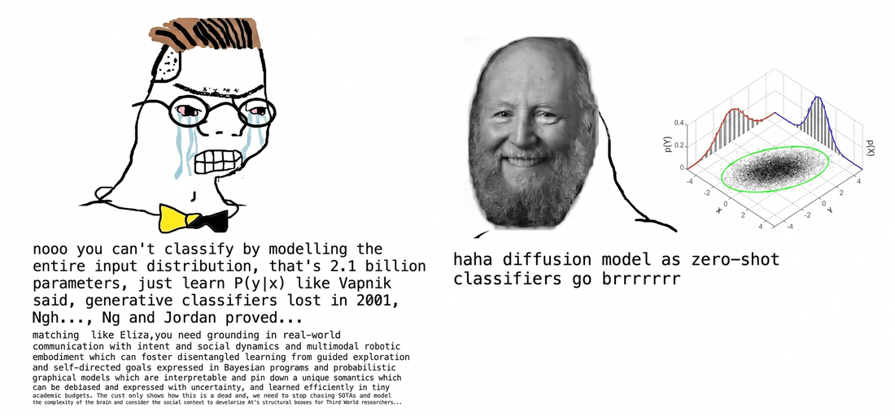
   
  <em>Ng and Jordan settled the debate. Then someone added a billion parameters and reopened it.</em>
   
  <small style="opacity: 0.7;">
    Meme & opening premise inspired by Horace He's <a href="https://horace.io/brrr_intro.html">blog post</a>.
  </small>

### 1.1 The literal Meaning

An algorithm is a procedure crafted by humans to perform a task, in Machine Learning algorithms are designed to imitate learning something about given data. This mental model gives us a clear anchor to distinguish between generative and discriminative algorithms:

- Generative algorithms learn how to recreate. Their upper-bound ability is to create new datapoints from randomness with high likelihood (highly likely for now) to belong to the original dataset the algorithm used to learn.

- Discriminative algorithms have no representation of how datapoints are distributed or generated. They simply learn a mapping from features to target values or the probability of a datapoint belonging to a class.

in data science datapoints look like this: 

| Median Income | HouseAge | AveRooms | AveBedrms | Population | AveOccup | Latitude | Longitude | **MedHouseVal** |
|---:|---:|---:|---:|---:|---:|---:|---:|---:|
| $833K | 41 | 6.98 | 1.02 | 322 | 2.56 | 37.88 | −122.23 | **$4.53M** |
| $830K | 21 | 6.24 | 0.97 | 2401 | 2.11 | 37.86 | −122.22 | **$3.59M** |
| $726K | 52 | 8.29 | 1.07 | 496 | 2.80 | 37.85 | −122.24 | **$3.52M** |
| $564K | 52 | 5.82 | 1.07 | 558 | 2.55 | 37.85 | −122.25 | **$3.41M** |
| $385K | 52 | 6.28 | 1.08 | 565 | 2.18 | 37.85 | −122.25 | **$3.42M** |

  
  <small style="opacity: 0.7;">
    Obtained from Califronia Housing  <a href="https://www.kaggle.com/datasets/camnugent/california-housing-prices">dataset</a>.
  </small>

here our input could be all the columns except the Median House Value( = $X$) and our output or label could be median house value( = $y$).

So a generative model will create a join probability distribution of $y,X$ to predict $y$ for an $X$ that was not necessarily seen in original dataset, while discriminative model would create a direct mapping from $X$ to $ y$ using conditional probability $P(y \mid X)$.

The important distinction is therefore not simply **“generative models generate, discriminative models classify.”** It is about **what we choose to learn**. A discriminative model learns the part of the world needed to make a decision; a generative model attempts to learn enough of the underlying distribution that we can do more than just make that decision.

<!--`i doubt if this para is required`While a discriminative model makes assumptions about the output given the input(f(X) given X/ class given object), a generative model also makes assumptions about the input. These assumptions are usually in the form of probability distributions(reference to below sections).-->

<!--
> **Note:** We will now focus on generative and discriminative classifiers, the derivations, merits and comparisons of general generative and disriminative models are dealt with in section 3
> We now focus on generative and discriminative classifiers; their other merits and comparisons are dealt with in sections 2 and 3.-->

### 1.2 Comparison as Classifiers

To further evolve on our <!--introductory--> understanding of generative and discriminative models, let's look at them as classifiers, as this is where the distinction is most visible.

Understanding <!--Starting off--> with an analogy:

> **Scene:** A stranger arrives at the edge of two countries. Which one do they belong to? Two experts can answer:
>
> Let $y$ be the random variable for belonging to one of the countries, and $X$ be the random variable denoting the characteristics of our stranger (multidimensional).
>
> **The Cartographer (Generative)**  
> Surveys the entire landscape—where people live, what towns look like, and regional density—to determine where you belong. 
>
>A generative model tries to understand the world that could have produced the observation: what does a datapoint from class $y$ tend to look like, and how common is that class? 
>
> *Has information of:* $P(X, y)$, the joint probability that a person is from country $y$ **and** has attributes $X$.
>
> **The Border Guard (Discriminative)**  
> Cares only about the boundary line and which side you fall on.  
>
> A discriminative model skips that reconstruction and asks a single question: given what I can observe, which answer is most likely?
>
> *Has information of:* $P(y \mid X)$, the probability that the person belongs to country $y$, **given** having attributes $X$.

>**Classification task**: to assign an instance(datapoint) of some object (like animals, shapes), using their feature vector (like shape, sound, etc..), to one of the classes labelled in our dataset (like {mammal, reptile}/{dog, cat}, {digits}).

<figure style="text-align: center; margin: 20px 0;">
  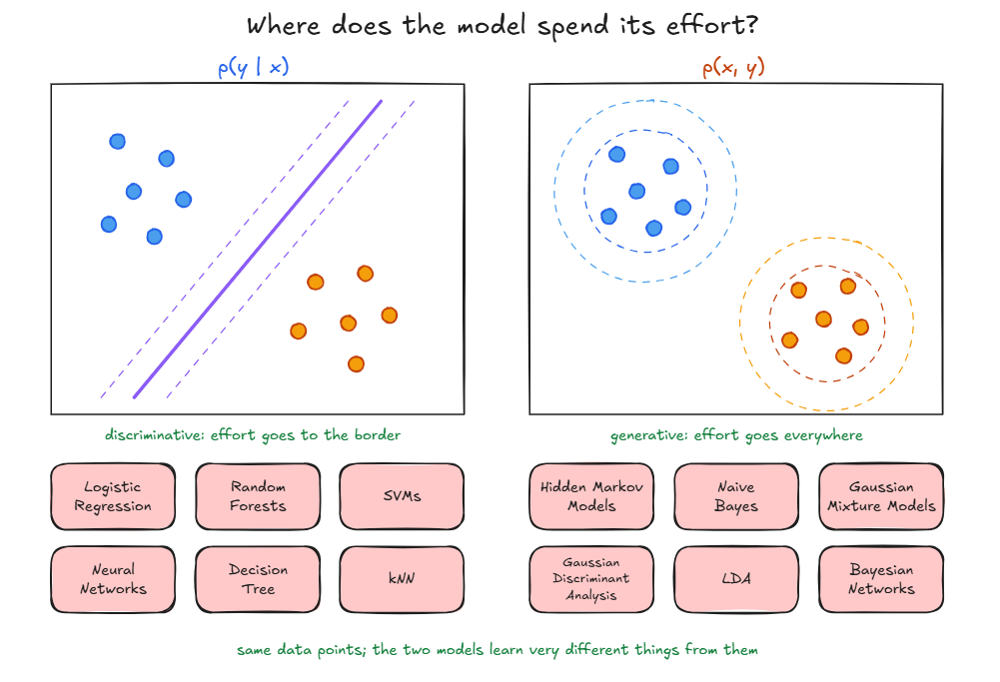
  <figcaption style="margin-top: 8px; font-size: 0.9em; color: rgb(165, 143, 220);">
    <em><strong>Left:</strong> The blue line represents a decision boundary separating two classes (Discriminative). 
    <strong>Right:</strong> The contours represent points of equal probability density (Generative).</em>
  </figcaption>
</figure>

### 1.3 Ideal relationship

Three kinds of probabilistic views are of most concern.
- The joint $P(X, y)$ is the chance of both things at once.
- The marginal $P(X)$ is of instance appearing independent of class.
- The conditional $P(y \mid X)$ is the probability of y in the isolated space of X.

With the underlying mathematics stated, we can exploit Bayes formula of probability theory to better understand underlying relations behind these models.

$$P(y \mid X) = \frac{P(X, y)}{P(X)}$$

where, $P(X)$ can be obtained directly using $P(X) = \sum_{y'} P(X, y')$.

This means we can generate the results of a discriminative algorithms from generative algorithm trained over representative data.

### Contstraints 
Like in ideal physics we ignore air drag, the above established relationship ignores practical limits on several fronts, the models are bound by:

1. Every algorithm can learn only what its structure allows inherently. For a generative algorithm, it is a set of possible $P(X, y)$. Naive Bayes, for instance, can only offer distributions in which the features are independent given the class. For a discriminative algorithm, it is a set of possible mappings $X \to y$: a straight or polygonal line, a smooth curve. 
Such misspecification leads to impossibility of an intuitively obvious fitting, as in a straight line cannot specify XOR. and no single Gaussian can fit a class with two peaks, it ends up straddling the valley between them (Fig 9.8 in 3.5).

<!--The two sides differ in *where* the mistake shows up. A discriminative model is wrong about the very thing you evaluate, so a bad boundary appears directly in your accuracy. A generative model is wrong about $P(X \mid y)$, and that damage reaches $P(y \mid X)$ only indirectly, through Bayes' rule, which is generally harder to spot and harder to fix.-->

2. Real models have limited capacity, so what we ask them to optimise matters. A generative model must learn how the inputs themselves are distributed, including details that may be irrelevant to predicting (y),such as an image's background or rare words in a document. A discriminative model can focus directly on the relationship between (x) and (y), without needing to explain all of (x).

2. The learning computational cost is more for a generative algorithm:

    | Model | Parameter Formula | Value for $d = 30$ | Interpretation |
    | :--- | :---: | :---: | :--- |
    | **Full Joint $P(X, y)$** | $2^{d+1} - 1$ | $\approx 2.1 \times 10^9$ | Learns every feature combination directly; computationally intractable |
    | **Naive Bayes** | $2d + 1$ | $61$ | Assumes conditional feature independence given class |
    | **Logistic Regression** | $d + 1$ | $31$ | Learns only the linear decision boundary weights plus bias |

    - If the structure of model is too simple, to capture signal it is biased, if it is so sensitive that it captures noise, it has high variance, and there is no tranisition boundary, the ability to capture a signal might result also in capturing some noise.

3. **Getting $P(y | X)$ at prediction time** (using the model) — Even a perfect joint needs $P(X)$, a sum over every class or, for rich models, over every possible input. Trivial for two classes, very expensive for deep models.

3. Checking a discriminative model is relatively straightforward: we can measure its accuracy on y. But verifying whether a generative model has learned the true distribution P(x) is much harder. A model can assign high likelihood to observed data while still misrepresenting important features or unseen cases, making generative errors harder to detect directly, for example it might be right in 50% cases by giving importance to a logically wrong feature, and the training process might prime for it, this can happen for multiple features over multiple chunks.

#### What this means for each model

Essentially this constrains us to a different level for each model. This hinders generative algorithms such that the issues are much harder to realise and fix, you judge the classifier by accuracy on y, but the error originates in $P(X \mid y)$, adding a layer of abstraction and error propogation. The likelihood paradox ([Do Deep Generative Models Know What They Don't Know?](https://arxiv.org/pdf/1810.09136)) is an extreme example.
While the convergence ability of a descriminative algorithm requires a lot of data, which may be hard to get, and can increase number of outliers.

So the playing field is more level than it first looked: each paradigm pays for its strengths somewhere. So its not hierarchical, the problems play a large role in decision.<!--The useful question is no longer which one is better, but what structure in a problem calls for which kind of model.-->

### 1.4  The Problem Statements:
One of the goals of this blog is to develop an intuition for when a generative model is necessary and when a discriminative model is sufficient. <!--Before diving into the origins and evolution of these two approaches, it helps to build a broad mental model that we can keep refining throughout the blog.-->

  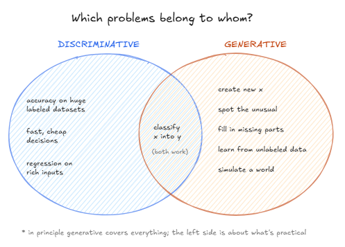
   
  <em>Set representation of model based problems</em>
   

### Discriminative models

Discriminative approaches provide a direct attempt to compute the input to output mappings for classification and regression and eschew the modeling of the underlying distributions. [^1]

while discriminative models can be used for 
- classification or 
- regression. 
They make fewer assumptions about how the data is generated and work especially well when labelled data is abundant.
Once trained, they are also typically cheap and fast to use, making them practical for real-time or high-volume predictions.

### Generative models

Generative approaches produce a probability density model over all variables in a system and manipulate it to compute classification and regression functions. [^2]

Once a model has learned the underlying data, there are many ways we can put that knowledge to use. Generative models can
- help us sample 
- estimate densities 
- classify into categories using likelihood and bayes rule, 

Because they model relationships between variables, they can also use unlabelled data and handle missing information, often giving useful structure when labelled data is limited.
And when labels exist, a learned joint distribution (p(X,y)) can also give us (p(y\mid X)) through Bayes' rule.

---

>But rather than memorising these as fixed use-cases, I would suggest to understand what a model actually learns and then recognise what we can exploit from it for the problem at hand.

## 2 Foundations

Now that you have a basic and functional idea of what a generative/discriminative model is like, let's build them up from the foundational problem we aim to solve in Machine Learning "How can we learn from some examples and be correct about any other example" i.e. prediction
<!-- NOTE (do not apply): The opener frames ML as prediction only. Generative models also generate and score data. Consider "it's mostly about prediction". -->

To learn from examples, though, we first need words for what examples look like. <!-- LINK -->

## 2.1 Covariance and Correlation
Axiomatically, we treat everything we observe as being generated by some underlying, unknown probability distribution, the "distribution of nature."
<!-- NOTE (do not apply): The old California paragraph («To understand this with a concrete example…») is NOT reused. It describes rows as individual houses with square footage, but the dataset rows are districts (census block groups) with median values. The new beats use correct feature names. -->

Before looking at how features relate, we need two numbers that describe one feature on its own. The mean is its centre, where values sit on average. The variance is its spread, how far values typically stray from that centre. (If distributions themselves feel shaky, the [Math Preliminaries post](LINK-TBD) covers them.)

One feature has a spread. Two features can also move *together*. Covariance measures exactly that: positive when they tend to rise together, negative when one rises as the other falls, and near zero when there's no linear link between them.

Take the California housing data, where each of the roughly 20,640 rows is a district, not a single house. Median income and median house value rise together: richer districts have pricier homes, and the correlation between them is about 0.69 <!-- CHECK: r ≈ 0.69 -->. That's a clear positive link, though far from a perfect one.

Latitude and longitude go the other way, and you can see it. California runs diagonally from north-west to south-east, so the further north a district sits, the further west it tends to be: latitude up, longitude down. Their correlation is about −0.92 <!-- CHECK: r ≈ −0.92 -->. Plot the districts on a map and the cloud of points is a tilted ellipse.

Covariance has an awkward unit, though: income units times price units, or degrees times degrees. So its raw size can't be compared across pairs. Correlation fixes this by rescaling covariance to sit between −1 and +1, whatever the units: $\rho = \text{Cov}(a, b) / (\sigma_a \sigma_b)$, the covariance divided by both standard deviations. That's what makes 0.69 and −0.92 directly comparable.

One warning before moving on. Zero correlation does not mean independence. Take $Y = X^2$ with $a$ spread evenly around zero: $b$ is completely determined by $X$, yet the correlation is zero, because the link is a curve rather than a line. There is one important exception. If the variables are jointly Gaussian (the shape we write down below), zero correlation *does* mean independence. Naive Bayes will cash that in.

With more than two features, we collect every pairwise covariance into one table: the covariance matrix $\Sigma$. Entry $(i, j)$ is the covariance between features $i$ and $j$, and the diagonal holds each feature's variance, its covariance with itself. For California's eight features, that's an 8 × 8 table.

That table is exactly what shapes a multivariate Gaussian:

$$
\mathcal{N}(X \mid \mu, \Sigma) \propto \exp\!\left(-\tfrac{1}{2}(X - \mu)^\top \Sigma^{-1} (X - \mu)\right)
$$

Read it aloud: the probability falls off with a squared distance from the centre $\mu$, but a distance stretched and rotated by $\Sigma$. Points that are equally "far" in this sense form an ellipse. Rung 1 needs this exact form.

The figure below shows two-feature Gaussians as contour plots: the cloud seen from above, where each ring joins points of equal density. Write the two features of $X$ as $x_1$ and $x_2$. Reading $\Sigma$ by sight then takes three steps.

First, scale. Start with $\Sigma = I$, the identity matrix, with 1s on the diagonal and 0s elsewhere. That is the standard normal in two dimensions: a round cloud. At $\Sigma = 0.6I$ the cloud tightens; at $\Sigma = 2I$ it spreads out. The diagonal sets the spread along each axis. Because those entries are variances, doubling them widens the cloud by $\sqrt{2}$, not 2. <!-- CHECK: Σ = 2I gives standard deviation √2 per axis, so contours widen by √2 -->

  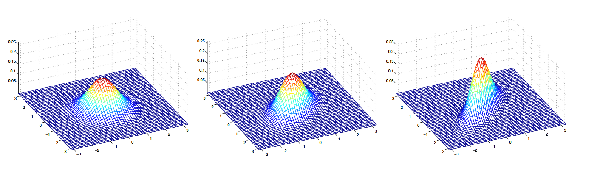
   
  
    Representative distributions for &Sigma;i with increasing,  Adapted from Andrew Ng, CS229 lecture notes.<i>i</i>
  

Second, tilt. Keep the diagonal at 1 and raise the off-diagonal entry:
$$\Sigma_1 = \begin{bmatrix} 1 & 0 \\ 0 & 1 \end{bmatrix}, \quad \Sigma_2 = \begin{bmatrix} 1 & 0.5 \\ 0.5 & 1 \end{bmatrix}, \quad \Sigma_3 = \begin{bmatrix} 1 & 0.8 \\ 0.8 & 1 \end{bmatrix}$$

As that entry grows from 0 to 0.5 to 0.8, the cloud is squeezed towards the line $x_1 = x_2$. With 1s on the diagonal, the off-diagonal entry is the correlation itself, so 0.8 means $\rho = 0.8$. Now flip the sign:

  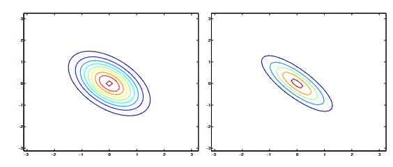
   
  
    Representative 2d contours for distributions with &Sigma;i with increasing,  Adapted from Andrew Ng, CS229 lecture notes. <i>i</i>
  

$$
\Sigma = \begin{bmatrix} 1 & -0.5 \\ -0.5 & 1 \end{bmatrix}, \quad
\begin{bmatrix} 1 & -0.8 \\ -0.8 & 1 \end{bmatrix}
$$
The squeeze now runs towards the opposite diagonal, $x_1 = -x_2$. Rescale California's latitude and longitude to variance 1 and their off-diagonal would be about −0.92: further along than the −0.8 panel, an even thinner ellipse on the downward diagonal.

Third, both together:

  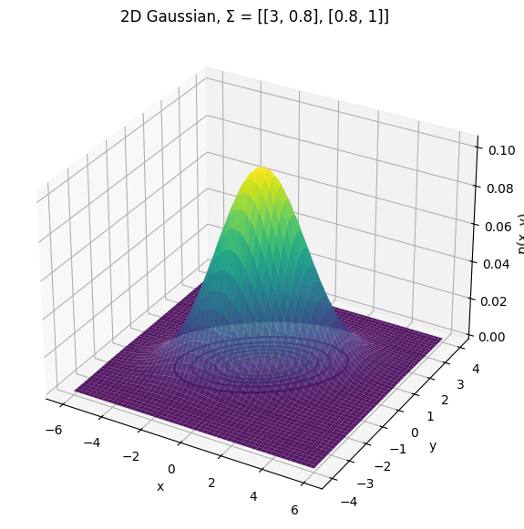
   
  
    Generated using python ^0^
  

$$
\Sigma = \begin{bmatrix} 3 & 0.8 \\ 0.8 & 1 \end{bmatrix}
$$

Now $x_1$ has three times the variance of $x_2$, which stretches the cloud along $x_1$, and the covariance tilts it: a general ellipse. The off-diagonal is no longer the correlation here: that is $0.8/\sqrt{3} \approx 0.46$. <!-- CHECK: ρ = 0.8 / (√3 · √1) ≈ 0.46 --> Finally, changing $\mu$ slides any of these clouds without changing its shape. Only $\Sigma$ sets the shape.

Now give each class its own cloud. If a new point lands somewhere between them, how do we decide which cloud it came from?

## 2.2 Bayesian Probability

We already saw the Bayes equation in section 1.3, lets look at a simple calculation to ensure common ground.

Say 20% of mails are spam, and the word "free" appears in 50% of spam and 5% of ham (legitimate mail). An email arrives containing "free". The spam route contributes $0.5 \times 0.2 = 0.10$, the ham route $0.05 \times 0.8 = 0.04$, and together they make up the evidence. So $P(\text{spam} \mid \text{"free"}) = 0.10 / (0.10 + 0.04) \approx 0.71$. Now keep the word statistics exactly as they are but drop the spam rate to 1%. The spam route shrinks to $0.005$, ham grows to $0.0495$, and the posterior falls to about 0.09 <!-- CHECK: 0.005 / (0.005 + 0.0495) ≈ 0.092 -->. Same word, same evidence about words, a completely different verdict. The prior matters.

That calculation is the whole generative-classifier recipe. Describe what each class looks like, $P(X \mid y)$; note how common each class is, $P(y)$; then flip with Bayes' rule to get $P(y \mid X)$.
<!-- NOTE (do not apply): Call it "Bayes' rule", never a "Bayesian classifier". 2.4 explains why using Bayes' rule doesn't make a model Bayesian. -->

With one word, describing $P(X \mid y)$ is easy. With thousands, we need a shortcut, and the most famous one is conditional independence: features that are independent *given the class*. "Free" and "winner" are correlated across all mail, because both turn up in spam. But within spam alone, we can assume that seeing "free" tells us nothing more about whether "winner" appears. That is *Naive Bayes's single assumption*. For Gaussian features, it has a familiar look from 2.1: zero correlation within each class means a diagonal covariance matrix, an axis-aligned cloud per class.

## 2.3 Likelihood and MLE

Our dataset is a handful of draws from an assumed distribution, each taken independently (i.i.d., independent and identically distributed).

So how do we tell a good guess from a bad one? We ask how well it explains what we actually saw. That score is likelihood.

Suppose you flip a coin 10 times and get 7 heads. Is the coin fair ($p = 0.5$) or biased ($p = 0.8$)?

Fair coin: $0.5^{10} \approx 0.00098$  
Biased coin: $0.8^{7} \times 0.2^{3} \approx 0.0017$
<!-- ✓ Numbers check out (0.000977 and 0.00168; ratio ≈ 1.72).
     SIMPLIFICATION fine: this is the probability of one specific sequence. The binomial
     coefficient would scale both equally, so the ratio and the best p don't change. -->

The biased coin explains the flips about 1.7 times better. Try every possible $p$ and the best one turns out to be $0.7$, exactly the fraction of heads you saw. Picking the guess that makes the observed data most likely is Maximum Likelihood Estimation (MLE). Formally, for data $\mathcal{D}$ and a family $\{P(\cdot \mid \theta) : \theta \in \Theta\}$ (our constraints), we choose

$$\hat{\theta}_{\text{MLE}} = \arg\max_{\theta \in \Theta}\; \mathcal{L}(\theta), \qquad \mathcal{L}(\theta) = P(\mathcal{D} \mid \theta)$$

The estimate is the parameter value under which the observed dataset is most probable, searched only within the family we allowed.

What $P(\mathcal{D} \mid \theta)$ means depends on the paradigm. A generative model scores inputs and labels together, while a discriminative model takes the inputs as fixed and scores only the labels given them:

$$\mathcal{L}_{\text{gen}}(\theta) = P(X, y \mid \theta), \qquad \mathcal{L}_{\text{disc}}(\theta) = P(y \mid X, \theta)$$

<!-- FIX: "All of this" opener removed because the paragraph is now self-contained; check the preceding paragraph still leads in. -->

MLE is the engine nearly every model in this blog runs on.
<!-- FIX / SIMPLIFICATION needs follow-up: "nearly every" holds, but Slot E must name
     the exceptions: SVMs/perceptrons (minimise an error surrogate, no likelihood),
     GANs (adversarial objective), VAEs/diffusion (maximise a bound on the likelihood).
     Add a forward pointer here, or soften. -->
<!-- NOTE (do not apply): «MLE is the engine nearly every model…» needs a pointer to 2.6, where the exceptions are named. -->

Here is where the i.i.d. assumption gets used. If the $N$ examples are drawn independently from one distribution, the joint probability factorises into one term per example:

$$\mathcal{L}_{\text{disc}}(\theta) = \prod_{i=1}^{N} P\big(y^{(i)} \mid X^{(i)}; \theta\big), \qquad \mathcal{L}_{\text{gen}}(\theta) = \prod_{i=1}^{N} P\big(X^{(i)}, y^{(i)}; \theta\big)$$

In words, the dataset's score is every example's score multiplied together.

That product breaks computers. Multiply 10,000 probabilities of 0.5 and you get $0.5^{10{,}000} \approx 10^{-3010}$, while a float64 bottoms out near $10^{-308}$. Everything rounds to zero. Take the log instead:

$$\ell(\theta) = \log \mathcal{L}(\theta) = \sum_{i=1}^{N} \log P\big(\cdot^{(i)} \mid \theta\big)$$

This turns the product into a sum. And since $\log$ is strictly increasing, $\theta_1 \mapsto \mathcal{L}(\theta_1) > \mathcal{L}(\theta_2)$ if and only if $\ell(\theta_1) > \ell(\theta_2)$, so the maximiser doesn't move:

$$\arg\max_\theta \mathcal{L}(\theta) = \arg\max_\theta \ell(\theta) = \arg\min_\theta \big(-\ell(\theta)\big)$$

The last form is the negative log-likelihood (NLL), the loss most software actually minimises.

The coin shows it. With $h = 7$ heads and $t = 3$ tails,

$$\ell(p) = h \log p + t \log(1-p), \qquad \ell'(p) = \frac{h}{p} - \frac{t}{1-p} = 0 \;\Longrightarrow\; \hat{p} = \frac{h}{h+t} = \frac{7}{10}$$

The slope is zero exactly where the fraction of heads sits. Because $\ell''(p) = -h/p^2 - t/(1-p)^2 < 0$, that point is a maximum. 
This allows us to use ML optimization methods like gradient descent.

One last flip. Optimisers generally minimise, so we put a minus sign in front: maximising the log-likelihood is the same as minimising the negative log-likelihood, or NLL. Written out for a whole dataset: <!-- LINK -->

$$
\text{NLL}(\theta) = -\sum_{i=1}^{N} \log P(y^{(i)} \mid X^{(i)}; \theta)
$$

Where:
* **$\theta$**: The parameters of the model (weights, biases) that we want to tune.
* **$\mathcal{D} = \{(X^{(i)}, y^{(i)})\}_{i=1}^N$**: Our dataset containing $N$ independent training samples.
* **$P(y^{(i)} \mid X^{(i)}; \theta)$**: The probability assigned by the model (under parameters $\theta$) to the true label $y^{(i)}$ given input $X^{(i)}$.

This is the discriminative version: we score how likely the labels are given the inputs. The generative version instead scores the entire observation:

$$
-\sum_{i=1}^{N}\log P(X^{(i)},y^{(i)};\theta)
$$

Same recipe, different data being scored.

For some families, you never need to follow the slope at all, because the minimum can be written down directly. MLE for a Gaussian gives the sample mean for $\mu$ and the sample covariance for $\Sigma$, the one from 2.1, averaged over $N$ rather than $N - 1$. MLE for a Bernoulli is counting: the fraction of spam emails containing "free" is the estimate of $P(\text{"free"} \mid \text{spam})$, just as 7 out of 10 was the coin's $p$. So fitting GDA and Naive Bayes is arithmetic, not gradient descent. Logistic regression has no such closed form, so it has no choice but to follow the slope.

One caution before moving on. <!-- LINK -->
Written down, the likelihood is $P(\text{data} \mid \theta)$: the probability of the data, given parameters $\theta$. Read it carefully, because it points in a direction I percieve as unintuitive on superficial analysis.

## 2.4 Bayesian Inference

Bayesian probability gives a mathematical method of updating a prior, from new evidence.

<!--This is the same Bayes' rule as 1.3, just aimed at a different unknown. There we flipped $P(X \mid y)$ into $P(y \mid X)$ to learn the class; here we flip $P(\text{data} \mid \theta)$ into $P(\theta \mid \text{data})$ to learn the parameters: $P(\theta \mid \text{data}) \propto P(\text{data} \mid \theta)\, P(\theta)$. In words, the posterior is the likelihood times the prior, up to a constant that makes it add up to one.-->

Back to the coin. Start with a uniform prior of equally likely outcomes, and observe 7 heads and 3 tails. The prediction for the next flip is now $(7 + 1)/(10 + 2) \approx 0.67$, not 0.7: the data still dominates, but the guess has been pulled slightly towards our prior. That $+1$ acts like pseudo-counts, imaginary flips (one head, one tail) seen before the real ones. In Naive Bayes,we achieve the same outcome by Laplace smoothing.

We can go further by putting a prior belief on the parameters, adding $-\log P(\theta)$ to the objective{reference}, which analytically can mean things like (in different forms):
- The parameters are small, near zero,
- No words are impossible in a spam email, etc.

This gives Maximum A Posteriori (MAP) estimation, which connects directly to regularisation and weight decay. Or, instead of choosing one $\theta$, we can keep a distribution over possible $\theta$ values: Bayesian inference.

Full Bayesian inference never settles on one $\theta$. To predict, it averages the predictions of every possible $\theta$, each weighted by its posterior (the coin's 0.67 was one such average). That is more honest about uncertainty, since ten flips leave a wide spread of believable coins and ten thousand leave a narrow one, but the average is usually far more expensive to compute.

<!-- OPTIONAL: keep only if your Murphy reading covered it. -->
The same idea helps GDA when samples are scarce. A covariance matrix estimated from a few points is noisy, so we shrink it towards a simpler one, such as a diagonal, much as the prior pulled the coin towards fairness. <!-- CHECK: covariance shrinkage towards a diagonal/simpler target as a prior-like regulariser for GDA (Murphy; e.g. regularised discriminant analysis) -->

One distinction is worth holding onto. Applying Bayes' rule to classes, as in 2.2, does not make a model Bayesian. Naive Bayes flips $P(X \mid y)$ with Bayes' rule to classify, but the fitting algorithm utilises MLE for the best fit.

Look back, though, and every step so far has quietly assumed something.

## 2.5 No Free Guesses: Why Every Model Assumes:

Now we look at how any realistic task forces us to assume something about the data.

Classification makes this concrete. With $d$ binary features there are $2^d$ possible inputs, and learning the full joint $P(X, y)$ with no assumptions takes $2^{d+1} - 1$ free variables(a probability for each instance), about 2 billion for $d = 30$. Its not that, those are impossible to store, but they are mathematically intractable data is. With 10,000 examples, almost all of those 2 billion combinations are never seen even once. What should we predict for a combination we have never seen? Without any generalisation principle(a result of assumption), we simply can't  have an answer.
<!-- NOTE (do not apply): The 2^(d+1) − 1 count restates §1.2. Consider a pointer instead. -->
Regression hits the same wall from a different side. Through any finite set of points you can draw infinitely many curves, each disagreeing about what happens between and beyond them.
Assumptions  allow generalisation is a nice thought.

<!-- NOTE (do not apply): «built in shapes where it never needs to be computed» is vague. Name the escape routes (factorise, add hidden causes, learn a sampler) or point to Rung 3. -->

So the question is never whether a model assumes, but what it assumes about:

Generative models assume something about how $X$ is produced: features independent given the class (Naive Bayes), each class shaped like a Gaussian (GDA), hidden causes behind the data (latent-variable models).
Discriminative models assume only about the link from $X$ to $y$: the shape of the mapping (a line, a tree, a network) and the noise around $y$, which is what the loss function encodes.

We've already made five assumptions of our own. We treated the dataset as i.i.d. draws, which is what turned the likelihood into a product (2.3). We pictured each class as a Gaussian cloud (2.1). Whether those clouds share one covariance matrix or each get their own is a second, separate choice (2.1). We let features be independent given the class, Naive Bayes's one assumption (2.2). And we put a prior on the parameters (2.4). 
### Losses are assumptions too

	
If we assume a Gaussian distribution for the output, the NLL becomes MSE; if we assume a Bernoulli distribution, it becomes binary cross-entropy (BCE). In this sense, choosing a loss is choosing a probability distribution.
  

A discriminative model proposes a distribution for the target whose parameter is computed from the input. Write $f_\theta(X)$ for the network's raw output and $p(y \mid X;\theta) = p\big(y \mid f_\theta(X)\big)$ for the resulting density. With i.i.d. data (2.3),

  

$$

\text{NLL}(\theta) = -\sum_{i=1}^{N}\log p\big(y^{(i)} \mid f_\theta(X^{(i)})\big) \;=\; \sum_{i=1}^{N} \ell\big(y^{(i)}, f_\theta(X^{(i)})\big), \qquad \ell(y, f) := -\log p(y \mid f).

$$

  

So every probabilistic loss is a per-example penalty $\ell$ defined as $-\log$ of a density. The map also runs backwards: given a penalty $\ell$, the density is

  

$$

p(y \mid f) = \frac{e^{-\ell(y,f)}}{Z(f)}, \qquad Z(f) = \int e^{-\ell(y,f)}\,dy .

$$

  

This is a one-to-one correspondence between penalties and distributions **as long as $Z(f)$ does not depend on $f$**. When it does (for example, when the noise level is itself predicted from $X$), $\log Z(f)$ becomes part of the loss and the penalty changes shape. We will see exactly this in the Gaussian case.

  

#### Gaussian noise gives MSE

  

Write the target as $y = f_\theta(X) + \varepsilon$ and assume $\varepsilon \sim \mathcal{N}(0, \sigma^2)$ with $\sigma$ fixed. Then $y \mid X \sim \mathcal{N}(f_\theta(X), \sigma^2)$:

  

$$

p(y \mid X;\theta) = \frac{1}{\sqrt{2\pi\sigma^2}}\exp\!\left(-\frac{(y - f_\theta(X))^2}{2\sigma^2}\right).

$$

  

**Step 1: take $-\log$.** The log cancels the exponential, leaving the exponent:

  

$$

\ell(y, f_\theta(X)) = \frac{(y - f_\theta(X))^2}{2\sigma^2} + \tfrac{1}{2}\log(2\pi\sigma^2).

$$

  

**Step 2: sum over the dataset.** Write the residual as $r_i = y^{(i)} - f_\theta(X^{(i)})$.

  

$$

\text{NLL}(\theta) = \frac{1}{2\sigma^2}\sum_{i=1}^{N} r_i^2 \;+\; \frac{N}{2}\log(2\pi\sigma^2).

$$

  

**Step 3: remove what $\theta$ cannot move.** The second term has no $\theta$ in it. The factor $1/2\sigma^2$ multiplies the sum but is a positive constant, and multiplying an objective by a positive constant does not change where its minimum is. Therefore

  

$$

\arg\min_\theta \text{NLL}(\theta) = \arg\min_\theta \sum_{i=1}^{N} \big(y^{(i)} - f_\theta(X^{(i)})\big)^2 = \arg\min_\theta \text{MSE}(\theta).

$$

  

Gaussian noise gives you MSE. The gradient is worth keeping in mind:

  

$$

\nabla_\theta \text{NLL} = -\frac{1}{\sigma^2}\sum_i r_i\,\nabla_\theta f_\theta(X^{(i)}),

$$

  

each example pulls on $\theta$ in proportion to its residual.

  

**Step 4 (optional): what if $\sigma$ is unknown?** Treat $\sigma^2$ as a parameter and set $\partial\,\text{NLL}/\partial\sigma^2 = 0$:

  

$$

-\frac{1}{2\sigma^4}\sum_i r_i^2 + \frac{N}{2\sigma^2} = 0 \;\Longrightarrow\; \hat\sigma^2 = \frac{1}{N}\sum_i r_i^2 = \text{MSE}.

$$

  

The MLE of the noise variance is the training MSE itself. The fitted $\theta$ is unchanged, because $\hat\sigma^2$ only rescales the objective.

  

**Step 5 (optional): the linear case.** If $f_\theta(X) = \theta^\top X$, setting $\nabla_\theta\text{NLL} = 0$ gives the normal equations $X^\top X\,\hat\theta = X^\top y$, so $\hat\theta = (X^\top X)^{-1}X^\top y$ when $X^\top X$ is invertible. This is the least-squares fit that 2.6 obtained by conditioning a joint Gaussian on $X$.

  

**When the noise level varies.** Let the network also output $\sigma_\theta(X)$. Now $\log Z$ depends on $\theta$ and survives:

  

$$

\ell = \frac{(y - f_\theta(X))^2}{2\sigma_\theta(X)^2} + \log \sigma_\theta(X) + \text{const}.

$$

  

This is no longer MSE: it is a weighted squared error where uncertain inputs are down-weighted, and the $\log\sigma_\theta$ term stops the model from claiming infinite uncertainty to escape the penalty (Nix & Weigend, 1994; Kendall & Gal, 2017).

  

#### What MSE predicts: the conditional mean

  

Drop the Gaussian for a moment and ask what a squared-error loss estimates when the data has *any* distribution. For a fixed $X$, the best constant guess $c$ minimises the risk $R(c) = \mathbb{E}[(y - c)^2 \mid X]$:

  

$$

R'(c) = -2\,\mathbb{E}[y - c \mid X] = 0 \;\Longrightarrow\; c^\star = \mathbb{E}[y \mid X], \qquad R''(c) = 2 > 0.

$$

  

An equivalent view is the decomposition $\mathbb{E}[(y-c)^2] = \text{Var}(y) + (\mathbb{E}[y] - c)^2$: the irreducible variance is fixed, and only the second term depends on $c$. So a model trained with MSE and flexible enough to represent the minimiser converges to $f_\theta(X) = \mathbb{E}[y \mid X]$, whatever the true noise looks like. Gaussianity is what makes this estimator *the maximum likelihood one*; it is not what makes it estimate the mean.

  

#### Generalization
| Model | Variable modeled | Assumed distribution | Loss function | What the output estimates |
| :--- | :--- | :--- | :--- | :--- |
| **Regression (Discriminative)** | $y \mid X$ | Gaussian | MSE | Conditional mean $\mathbb{E}[y \mid X]$ |
| **Robust Regression** | $y \mid X$ | Laplace | MAE | Conditional median of $y \mid X$ |
| **Quantile Regression** | $y \mid X$ | Asymmetric Laplace | Pinball loss | $\tau$-quantile |
| **Logistic Regression** | $y \mid X$ | Bernoulli | BCE | $P(y=1 \mid X)$ |
| **Softmax Classifier** | $y \mid X$ | Categorical | CE | Class probabilities |
| **Count Regression** | $y \mid X$ | Poisson | Poisson NLL | Expected count |
| **GDA** | $X \mid y$ and $y$ | Gaussian, Bernoulli | Mahalanobis + CE | Class means, covariance, prior |
| **Naïve Bayes** | $X \mid y$ and $y$ | Bernoulli per feature | $d \times \text{BCE} + \text{CE}$ | Per-feature rates |
| **Autoregressive LM** | $x_t \mid x_{<t}$ | Categorical | CE per token | Next-token distribution |
| **VAE (Gaussian Decoder)** | $x \mid z$ | Gaussian | MSE + KL divergence | Conditional mean image |
| **Diffusion** | $x_{t-1} \mid x_t$ | Gaussian | MSE on noise | Added noise $\epsilon_\theta$ |
| **GAN** | *None (implicit)* | *None* | BCE / Adversarial | Density ratio $\rightarrow$ JS divergence |

> For exact derivations of each model, look at [References and further reading](#references-and-further-reading).

<!-- FIGURE 1: penalty curves $\ell(r)$ for Gaussian (parabola) and Laplace (V shape) with matched variance, plus their influence functions $\psi(r)$ underneath; mark the 10-sigma point. -->

<!-- FIGURE 2: the 2, 3, 10 example. Plot $S(c)$ and $A(c)$ over $c$, with minima marked at 5 and 3; optionally a second panel with 10 replaced by 100. -->

<!-- FIGURE 3: BCE vs MSE-on-sigmoid for $y=1$: loss and gradient against $f$, showing the vanishing gradient at $f \to -\infty$. -->

<!-- FIGURE (existing): distributions behind the losses, image-6.png, can stay beside the summary table. -->
  

> **Cross-entropy:**  Suppose a model looks at an image and outputs probabilities for each class, say cat 0.7, dog 0.2, bird 0.1. If the true answer is "cat," cross-entropy ignores the other classes and asks only one question: *how much probability did the model put on the correct answer?* The loss is $-\log p$, where $p$ is that probability.
>
> If the model gave the right answer a high probability ($p \approx 1$), the loss is close to zero. If it was unsure ($p = 0.4$), the loss is moderate. If it was confidently wrong ($p = 0.05$), the loss is large. Training with cross-entropy therefore pushes the model to put as much probability as possible on the correct class, and it punishes confident mistakes far more than hesitant ones.

<!-- FIGURE: distributions behind the losses (moved from beside the table; SOURCE alt text "Distribution visualization"). -->

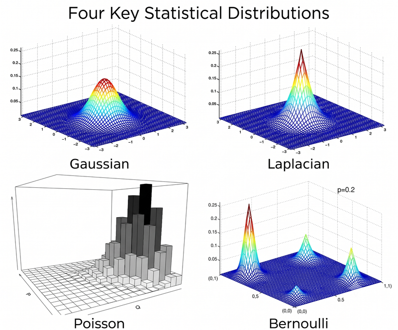

  

California shows a family breaking. Prices are right-skewed, and the target (median house value, in units of \$100,000) is capped at about \$500,000<!-- CITE: verify the cap value with the fact-check prompt. -->, so many districts pile up at the cap. A Gaussian on raw price fits badly. The common fix is to model log-price, which amounts to swapping the family. (The i.i.d. assumption is shaky too: neighbouring districts aren't independent draws, a simplification we live with.) To catch either problem, look at the residuals: their shape, their tails, and whether their spread grows with the prediction.

Every loss in the table is a bet on a distribution, and the bet can be checked. Fit the model, then look at the residuals: if their shape, tails or spread disagree with the assumed family, the loss is answering a question the data did not ask. Changing the family (log-price, Laplace noise, a Student-t) changes the loss and what the model estimates.

The table also shows that these losses do not all score the same probability. The regression and classification rows score $p(y \mid X)$. The GDA and Naive Bayes rows score $p(X, y)$. The autoregressive, VAE and diffusion rows score $p(X)$ or a bound on it, and the GAN row scores no likelihood at all. Fixing the family does not fix this choice. Which quantity to score is the next question, and it is the most evident part of modelling where generative from discriminative models separate.

<!-- NOTE (do not apply): Keep the CITE marker on the $500,000 cap. -->

<!--#### References

1. Bishop, C. M. (2006). *Pattern Recognition and Machine Learning*. Springer. §1.2.5 (Gaussian noise and sum-of-squares), §4.3.6 (canonical link functions). <!-- CHECK: section numbers 
2. Hastie, T., Tibshirani, R., Friedman, J. (2009). *The Elements of Statistical Learning*, 2nd ed. §2.4 (squared error gives the conditional mean, absolute error the median). <!-- CHECK: section number 
3. McCullagh, P., Nelder, J. A. (1989). *Generalized Linear Models*, 2nd ed. Chapman & Hall.
4. Koenker, R., Bassett, G. (1978). Regression quantiles. *Econometrica*, 46(1), 33–50.
5. Huber, P. J. (1964). Robust estimation of a location parameter. *Annals of Mathematical Statistics*, 35(1), 73–101.
6. Nix, D. A., Weigend, A. S. (1994). Estimating the mean and variance of the target probability distribution. *Proc. IEEE ICNN*.
7. Kendall, A., Gal, Y. (2017). What uncertainties do we need in Bayesian deep learning for computer vision? *NeurIPS*.
8. Kingma, D. P., Welling, M. (2014). Auto-encoding variational Bayes. *ICLR*.
9. Ho, J., Jain, A., Abbeel, P. (2020). Denoising diffusion probabilistic models. *NeurIPS*.
10. Goodfellow, I. et al. (2014). Generative adversarial nets. *NeurIPS*.
11. Cover, T. M., Thomas, J. A. (2006). *Elements of Information Theory*, 2nd ed. Wiley. (cross-entropy, KL)
-->
<!-- CUT? candidate -->
>

<!--California shows a family breaking. Prices are right-skewed, and the target (median house value, in units of \$100,000) is capped at about \$500,000<!-- CITE: verify the cap value with the fact-check prompt. , so many districts pile up at the cap. A Gaussian on raw price fits badly. The common fix is to model log-price, which amounts to swapping the family. (The i.i.d. assumption is shaky too: neighbouring districts aren't independent draws, a simplification we live with.) To catch either problem, look at the residuals: their shape, their tails, and whether their spread grows with the prediction.
<!-- NOTE (do not apply): Keep the CITE marker on the $500,000 cap. 

The machinery that turns any distribution into its loss is covered in more depth in the Logistic Regression + GLMs post.-->

## 2.6 The Objective Decides, Not the Algorithm
 
2.5 showed that a loss is a distribution in disguise, and that the same recipe applies to $y$ given $X$ or to $X$ itself. It left open which quantity we should score. Two models can share an architecture and an optimiser; the criterion they optimise decides which kind of model we have. There are three choices. With inputs $X$ and a target $y$ (a class, a number, a sequence), you can:
 
1. **Model everything:** maximise $\log p(X, y)$. Pure density estimation, $\log p(X)$, is the extreme case with no target at all.
2. **Model just the target:** maximise $\log p(y \mid X)$ and say nothing about $X$.
3. **Just get the prediction right:** minimise a loss like squared error or 0–1 error. Each loss quietly picks one summary of $p(y \mid X)$: squared error the mean (2.5) and absolute error the median (see further reading), 0–1 error the most likely class (the expected 0–1 loss of guessing $c$ is $1 - p(c \mid X)$, smallest at $\arg\max_c p(c \mid X)$).
The first two are linked by one line:
 
$$
\log p(X, y) = \log p(y \mid X) + \log p(X).
$$
 
So a generative model does the discriminative job *plus* the extra work of explaining $X$. If that explanation is right, it's free information and you need less data. If it's wrong, the mistakes leak into your predictions. This happens only when the parameters describing $X$ are **tied** to the ones used for predicting $y$. If they're separate, $\log p(X)$ can't affect the predictor, and both objectives give the same answer.
<!-- CITE: Minka 2005, "Discriminative models, not discriminative training". -->
 
| Problem | Generative | Discriminative |
|---|---|---|
| Classification | Naive Bayes, GDA | Logistic regression |
| Sequence labelling | HMM | CRF |
| Regression | Joint Gaussian on $(X, y)$ | Linear regression |
| Density estimation | Maximum likelihood | Noise-contrastive estimation |
 
**Classification.** GDA (Gaussian classes, shared covariance) ends up with $p(y=1 \mid X) = \sigma(w^\top X + b)$, exactly logistic regression's form. But GDA gets $w$ from the class means and covariance, so its boundary is *tied* to how it models $X$; logistic regression fits $w$ directly. Rung 1 derives this and asks who wins.
 
**Regression.** Fit a joint Gaussian to $(X, y)$, condition on $X$, and you get a linear mean function with *exactly* the least-squares coefficients. The parameters aren't tied, so the predictions match, and the generative version adds a density over $X$ as a bonus.
 
**Density estimation.** With no input–output split there is nothing to condition on, so the problem is generative by construction. Even so, the same choice appears: fit $p(X)$ by maximum likelihood, or train the same model as a classifier that tells real data from noise.
<!-- CITE: Gutmann & Hyvärinen 2010 (noise-contrastive estimation). -->
 
The choice is not reversible. A discriminative $P(y\mid X)$ does not give back $P(X,y)$: a spam classifier never had to learn how emails are distributed, and many different $P(X)$ produce the same $P(y\mid X)$.
 
**When "tied" bites.** Take one-dimensional data with class 0 near $X = -1$ and class 1 near $X = +1$, so the boundary sits near 0. Add a cluster of class-1 points at $X = 100$. They are already on the correct side, so a sensible classifier should shrug. Fit three models:
 
- **Logistic regression** (conditional likelihood) shrugs. Those points get probability ≈ 1, so their loss and gradient are ≈ 0, and the boundary barely moves.
- **GDA** (joint likelihood) can't ignore them, because it must *explain* every $X$. The class-1 mean jumps right and the shared variance balloons. The boundary is computed from exactly these quantities, so it moves, and ordinary class-1 points near $+1$ can end up misclassified.
- **Least squares on 0/1 labels** (MSE) fails differently. The line predicts values far above 1 at $X = 100$, those correct points show huge residuals, and flattening the line to shrink them drags the boundary out of place. This is the mismatch from 2.5: MSE assumes Gaussian noise, but the labels are Bernoulli, which calls for BCE (Bishop PRML Fig. 4.4; Nielsen, *Neural Networks and Deep Learning*, ch. 3).
<!-- CHECK: simulate all three in a few lines of code; report each boundary's shift. -->
 
You get what you optimise for, not what you intend ¯\\\_(ツ)\_/¯.

<figure style="text-align: center; margin: 20px 0;">
  
  <figcaption style="margin-top: 8px; font-size: 0.9em; color: #a0a0a0;">
    <em><strong>The Jebara Grid:</strong> Objective functions (columns) versus parameter estimation methods (rows).</em> 
    
      Every method sits in one cell: the objective picks the column ($\log P(X, y)$, $\log P(y \mid X)$, or prediction loss), while the treatment of $\theta$ picks the row ($\text{MLE}$, $\text{MAP}$, or full Bayes).
    
  </figcaption>
</figure>*
 
Putting the two choices side by side gives a grid, after Jebara <!-- CHECK: Jebara 2004, "Machine Learning: Discriminative and Generative" as the source of the grid -->. The columns are the three objectives above. The rows are a single best $\theta$ by MLE (2.3), a prior-nudged one by MAP, or the whole spread by full Bayes (2.4). The blue bracket spans the two right-hand columns: everything that never models $X$ is discriminative.
 
Not every method fits a cell. When the likelihood is hard to compute, deep generative models optimise either a bound on it (the ELBO in VAEs, the noise-prediction loss in diffusion) or a classifier loss standing in for it (the GAN discriminator, noise-contrastive estimation).
 
So NLL is a very common starting point, but it is not the definition of how ML models must be trained.
 
## 2.7 The Root Question, the Map, and the Messy Middle

So, handed any model, how do you tell which side it's on? Ask one question: does it assign probability to $X$? If yes, it's generative. If no, and it only maps $X$ to an output (a probability, a number, a verdict, a ranking), it's discriminative. The three objectives from 2.6 then split the discriminative side in two. A generative model scores $p(X, y)$ or $p(X)$. A probabilistic discriminative model scores only $p(y \mid X)$. A discriminant function skips probability altogether and maps $X$ straight to a verdict by minimising a loss, as an SVM does.

<!-- FIGURE: taxonomy map (existing Mermaid blueprint). Root question at the top; generative (orange) vs probabilistic discriminative and discriminant function (blue). Rung 3 families as names only. Non-classifiers on both sides. -->
*The map. Every model in this blog lands somewhere on it, including the ones that don't classify anything.*

**Example 1 (pure discriminative): a credit-scoring model.** A gradient-boosted tree model trained on past loan applications learns $p(\text{default} \mid \text{applicant})$ and nothing else. It's very good at ranking ordinary applicants by risk, but show it someone unlike anyone in the training data, say an applicant with an unusually high income and no credit history, and it will still produce a confident score. It has no way of saying "I've never seen anyone like this," because it never modelled what typical applicants look like.

**Example 2 (pure generative): a language model.** A model like GPT learns $p(X)$ over text, with no labels at all. It can write new sentences and tell you how plausible a given sentence is, but it isn't trained to answer any particular prediction question; anything like that has to be asked of it afterwards.
<!-- NOTE (do not apply): Example 2's «isn't trained to answer any particular prediction question» clashes with next-token training. The added sentence resolves it; consider softening the original too. -->
It is trained by predicting the next token (roughly, the next word), but the chain rule, $P(a, b) = P(a)\,P(b \mid a)$ applied token after token, multiplies those predictions into $P(\text{text})$: a generative model built from conditional parts.

<!-- NOTE (do not apply): Example 3 (spam) MOVES to Rung 1, where Naive Bayes vs logistic regression is done properly. Its «As in Section 2.6» reference and the "few hundred vs many thousands" figures need a source (Ng & Jordan give no such universal numbers). -->

Real systems often mix the two. For example, a discriminative network can compress the input into a compact representation, and a generative model can then be fitted on that compressed version. The label then applies to each part, not to the whole system.

Here is a concrete case. Take a network already trained to classify images and read off the features it has learned for each input. On those features, fit one Gaussian per class, all sharing one covariance matrix. For a new input, measure how far its features sit from the nearest class centre, using the stretched, rotated distance from 2.1. A large distance flags an unusual input, which is exactly what Example 1 had no way to do. <!-- CITE: Lee et al., NeurIPS 2018 (Mahalanobis-distance detector). --> That is GDA running on top of a discriminative network, and Rung 1 builds that GDA from scratch.

Before moving on, try placing each of these on the map: GDA, Naive Bayes, LDA, QDA, logistic regression, a gradient-boosted tree, GPT, and the discriminator inside a GAN. LDA and QDA are new names, but both are close relatives of GDA, so their spot shouldn't surprise you. The GAN discriminator is the interesting one: which side is it on, and which side is the system it lives in?

`
<!--Rung 1: Generative Classifiers
Intro: it bifurcates into GDA and Naive Bayes, from a common equation(I have the assets)
GDA: 

Its formula, distributions and assumptions(common covariance matrices, its effect, why it 1. When it becomes LDA 2. Its form as QDA
the disriminant function and how we can optimise it( I have stuff from MLP1) 1. How the model fits and why it does. 2. MLE for gaussian
Why the mle easily overfits and its solutions and why they work 1. tied covariances 2. diagonal covariances 3. MAP estimation
Fischer's Linear Discriminant Analysys
Naive Bayes

NB assumption and its effects and why it being wrong works empirically
its low params size and why this doesnt allow overfitting
Model fitting and MLE using Bayesian NB
Laplace smoothing and how it helps for spam classifiers
2: How generative classifiers and Logistic Regression/Softmax is Generative-Discriminative Pair

In this section there are a lot of decisions and we will prioritise showing first principles behind them

after this we will analytically study deep/non linear/structural models and setting (RL and stuff) in further rungs
then end with this
 The Reunion: Generative Classifiers

JEM → diffusion classifiers → shortcut robustness (ICLR 2025)
"Secretly" theme: JEM, diffusion classifiers, DPO
Full circle to Naive Bayes and Ng & Jordan

Decision Cheat Sheet + "Try it yourself" answers
Practical intuition, opinions, further reading

Your task is to 1. create a framework for this

find cool opinions / perspectives and points I can add in rung 1 anywhere
also note that some rung must cover what "diffusion model as zero shot classifier" means`
-->

# 3 Rung 1: Generative Classifiers

## 3.0 One Formula

A Generative Classifier uses Bayes rule to deternmine which class the instance belongs to:

$$P(y=c\mid X) = \frac{p(X\mid y=c)\,\pi_c}{\sum_{c'} p(X\mid y=c')\,\pi_{c'}}$$

<!-- CITE: image-7, Murphy, Probabilistic Machine Learning: An Introduction --> <!-- CHECK: exact equation number in PML Book 1 for this formula -->

Read it as follows. The chance that $X$ belongs to class $c$ is how well class $c$ explains $X$, times how common class $c$ is, divided by that same product summed over every class. The top scores one class while denominator is basically normalization.

The formula gets more revealing with two classes. Divide one posterior by the other and take the log:

$$\log\frac{P(y=1\mid X)}{P(y=0\mid X)} = \log\frac{p(X\mid y=1)}{p(X\mid y=0)} + \log\frac{\pi_1}{\pi_0}$$

In words, the log-odds equal the log-likelihood ratio plus the log prior ratio. The evidence has vanished, because it sits identically under both posteriors and cancels. What's left splits the decision cleanly in two: what $X$ itself says, plus a head start from how common each class is. With 2.2's 1% spam prior, spam begins about $\log(0.01/0.99) \approx -4.6$ behind geniune, and the words in a spam cover the gap to prove an email being spam.

$\pi_c$ is the baseline for every class, from our dataset, i.e. $\pi_c = N_c / N$. This is the fraction of training examples that belong to class $c$ inherently.

Different algebraic assumptions for $p(X \mid y = c)$ lead to different model:

<!--
## Verify

- The CITE source for image-7 is PML Book 1 (Murphy), and the exact equation number needs confirming.

## Judgement calls

- I rewrote the asset formula in rung notation ($\pi_c$ for $p(y=c\mid\theta)$, θ dropped), because θ alone isn't in the notation list.
- I displayed the asset formula as well as the log-odds line, reading "derivation steps" as both.
- The −4.6 head start is computed from 2.2's existing 1% prior, so it isn't a new fact. Cut it if it feels like an extra beat.
- I used lowercase $p$ for likelihoods and uppercase $P$ for posteriors, following the Facts equation.
- The cartographer callback is kept to a single clause, with no extension of the analogy.

-->

## 3.1 Different Branches

### 3.1.1 Gaussian Discriminant Analysis:
Here we consider a binary generative classifier, Gaussian Discriminant Analysis (GDA):

$$
\begin{aligned}
y &\sim \text{Bernoulli}(\phi) \\
x \mid y = 0 &\sim \mathcal{N}(\mu_0, \Sigma) \\
x \mid y = 1 &\sim \mathcal{N}(\mu_1, \Sigma)
\end{aligned}
$$

Besides the choice of distributions, we also assumed that both classes share one covariance matrix $\Sigma$. This is a modelling choice, not a requirement, and we make it for two reasons.

**It gives a linear boundary.** Take the log-odds with Bayes' rule. The $\Sigma$-dependent normaliser $\tfrac12\log|\Sigma|$ is the same for both classes and cancels, and so does the quadratic term $x^\top\Sigma^{-1}x$:

$$
\log\frac{p(y=1\mid x)}{p(y=0\mid x)} = \underbrace{\Sigma^{-1}(\mu_1-\mu_0)}_{w}{}^{\!\top} x \;-\; \tfrac12\big(\mu_1^\top\Sigma^{-1}\mu_1 - \mu_0^\top\Sigma^{-1}\mu_0\big) + \log\frac{\phi}{1-\phi}.
$$

This is linear in $x$, so $p(y=1\mid x) = \sigma(w^\top x + b)$, the logistic form from 2.6. 

$$\begin{aligned} \log p(y = c \mid x, \theta) &= \log \pi_c - \frac{1}{2}(x - \mu_c)^\top \Sigma^{-1}(x - \mu_c) + \text{const} \quad & \\ &= \log \pi_c - \frac{1}{2}\mu_c^\top \Sigma^{-1}\mu_c + x^\top \Sigma^{-1}\mu_c + \text{const} - \frac{1}{2}x^\top \Sigma^{-1}x \quad & \\ &= \underbrace{\log \pi_c - \frac{1}{2}\mu_c^\top \Sigma^{-1}\mu_c + \text{const}}_{\gamma_c} + \underbrace{\vphantom{\frac{1}{2}}\Sigma^{-1}\mu_c}_{\beta_c} x^\top \underbrace{-\frac{1}{2}x^\top \Sigma^{-1}x}_{\kappa} \\ &= \gamma_c + x^\top \beta_c + \kappa \quad  \end{aligned}$$
The final term is independent of $c$, and hence is an irrelevant additive constant that can be dropped. Hence we see that the discriminant function is a linear function of $x$, so the decision boundaries will be linear. 

$$\delta_c(X) = \log \pi_c - \tfrac{1}{2}\log|\Sigma_c| - \tfrac{1}{2}(X - \mu_c)^\top \Sigma_c^{-1}(X - \mu_c)$$

The score for class $c$ adds three things: the prior, a penalty for a spread-out class, and the stretched distance from $X$ to that class's mean. We classify by picking the class with the highest $\delta_c(X)$.

<!-- ASSET MISSING: MLP1 material on the discriminant -->
Each of the three pieces has a job. $\log \pi_c$ is the head start from 3.0. $-\tfrac{1}{2}\log|\Sigma_c|$ penalises classes with a large determinant, which is roughly the volume of the cloud. A wide cloud spreads its probability thin, so it can't claim any single point strongly. The last term is 2.1's stretched distance, which measures how far $X$ sits from $\mu_c$ in units set by that class's own shape.

This is QDA, quadratic discriminant analysis. Every class keeps its own $\Sigma_c$, so the quadratic term $X^\top \Sigma_c^{-1} X$ hidden inside the distance differs from class to class. Set two scores equal to find the boundary, and that difference doesn't cancel. The boundary is quadratic in $X$, so it curves.

**It needs fewer parameters.** One $\Sigma$ has $d(d+1)/2$ free parameters, while two cost twice that. With limited data in high dimensions, the shared estimate is more stable, at the price of being wrong when the classes really have different spreads.

<figure style="text-align: center; margin: 20px 0;">
  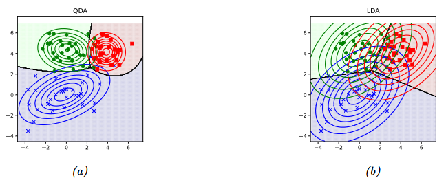
  <figcaption style="margin-top: 8px; font-size: 0.9em; color: #a0a0a0;">
    <em>QDA and LDA on the same data.</em>
  </figcaption>
</figure>

So here is the first principle, stated plainly. The boundary curves exactly when the classes' shapes differ. Same shape, and the quadratic parts cancel into a line. Different shapes, and they don't. Nothing about the data's difficulty decides this. The covariance assumption alone does.

Fit both models to the same data and the difference is hard to miss.

There is one more fork. Keep a separate $\Sigma_c$ per class, but force it to be diagonal, so every off-diagonal entry is zero. That says the features are uncorrelated within each class. For Gaussians, as 2.1 and 2.2 showed, zero correlation is the same as independence, so this is conditional independence: once you know the class, one feature tells you nothing about another. This model is Gaussian Naive Bayes. Swap the Gaussian for a coin per feature and you get the spam filter in 3.1.2.

The four ellipse panels from 2.1 turn out to be four classifiers in disguise.

<!-- FIGURE: The four ellipse panels from 2.1, relabelled as classifiers. Spherical → nearest centroid (shared σ²I, equal priors: assign to nearest class mean). Diagonal → Gaussian Naive Bayes. Shared full → LDA. Different tilts → QDA. -->
*Caption placeholder: each covariance assumption from 2.1, named as the classifier it produces.*

<!---

## Verify

- No new CHECK items. All formulas come from the kit's "Facts for the drafter", and the remaining claims are callbacks to 2.1, 2.2 and 3.0.

## Judgement calls

- Neither image-8 nor the MLP1 material was attached, so I wrote both beats from the Facts list and added ASSET MISSING markers.
- I derived δ_c(X) in one sentence (log of 3.0's numerator, with the denominator and constant dropped) so the reader sees where it comes from. Cut that sentence if it counts as an extra beat.
- I glossed $|\Sigma_c|$ as "roughly the volume of the cloud", since the reader may not read determinants geometrically.
- I added "priors slide the line, never tilt it" as the reading of the boundary equation. It follows directly from $b$, but it's my emphasis.
- I left out the link to logistic regression's form (2.6) after the boundary equation, to avoid pre-empting the later pairing section.
- I didn't mention that per-class diagonal covariances still give curved boundaries. The first principle implies it, but no beat asked for it.
- I gave the image-8 beat a single lead-in line so the figure isn't described in prose.

**Do not apply (comments for you):** the "three LDAs" naming box lives in 3.4; don't explain the name here.

-->
### 3.1.2 Independent Features: Naive Bayes

$$P(X \mid y = c) = \prod_{j=1}^{d} P(x_j \mid y = c)$$

The probability of the whole email under a class is the product of each feature's probability under that class, taken one at a time. That one assumption is the entire model. It doesn't care whether $x_j$ is a word, a count or a temperature. You only need to pick a distribution for each feature on its own, and that is far easier than describing how $d$ features move together. In the spam example from 2.2, it means "free" and "winner" each give their own verdict and we multiply the two.

That shortcut has a cost. "Free" and "winner" turn up together in spam far more often than chance would predict, so they are really one piece of evidence wearing two hats. Naive Bayes counts it twice. If each word alone makes spam 5 times more likely, the model multiplies those and gets 25. Every correlated pair inflates the score the same way, so the posteriors get pushed towards 0 and 1. So there's obvious shortcoming in Naive Bayes Assumption, then why does it perform so well.

Accuracy only asks which class scores highest. If the true posterior for spam is 0.7 and Naive Bayes says 0.99, the probability is badly wrong, but the email still lands in the spam folder. The double counting stretches the scores without usually flipping their order. That is the first principle here: accuracy asks less of a model than probability does. A model can fail the harder test and pass the easier one.

The construction leaves one choice open, which is the distribution for each feature, and each choice has a name. Bernoulli Naive Bayes treats every word as present or absent, with $P(x_j = 1 \mid y = c) = \theta_{jc}$, and it is the model behind our spam example. Multinomial Naive Bayes counts words instead, with $P(X \mid y = c) \propto \prod_j \theta_{jc}^{n_j}$. Here $\theta_{jc}$ is the chance that any one word in a class-$c$ email is word $j$, and it is usually the better choice for large vocabularies (McCallum & Nigam, 1998). <!-- CHECK: McCallum & Nigam 1998, multinomial beats Bernoulli on large vocabularies --> Gaussian Naive Bayes handles continuous features, and it is exactly the diagonal GDA from 3.1.1. Bayesian Naive Bayes is the same model with a prior on its parameters, and we'll fit it shortly.

<!---

## Verify

- Domingos & Pazzani (1997): Naive Bayes can be optimal under zero-one loss even with violated independence.
- Zhang (2004): dependencies can cancel each other out across features.
- Zadrozny & Elkan (2001): calibration of Naive Bayes probabilities after training.
- The URL for the Evals post.
- McCallum & Nigam (1998): multinomial usually beats Bernoulli for large vocabularies.

## Judgement calls

- The "5 times → 25" double-counting figure is an illustrative hypothetical, not a measured fact.
- I described Naive Bayes as overconfident "almost all the time" on real text. This is an emphasis the beat implies, not a citation. Soften it if you prefer.
- I wrote the variants as four sentences in one paragraph rather than a list, to follow the no-bullets rule.
- I glossed the multinomial $\theta_{jc}$ as a per-word-slot probability, because it means something different from the Bernoulli $\theta_{jc}$ under the same symbol.
- "We'll fit it shortly" refers forward without naming the subsection.
- I placed the calibration CHECK after the Evals link so both markers sit together.

**Do not apply (comments for you):** Slot A (Naive Bayes → logistic regression) may go at the end of this subsection. Leave <!-- SLOT A? here.-->

## 3.2 Fitting Both: Why It's Closed-Form

Both GDA and Naive Bayes have a closed-form solution, but logistic regression needs an optimiser. The reason is how the log-likelihood falls apart, so we derive it step by step rather than assert it.

**Setup.** The data is $\mathcal{D} = \{(x_n, y_n)\}_{n=1}^{N}$ with $x_n \in \mathbb{R}^d$ and $y_n \in \{1,\dots,C\}$. Let $N_c = \sum_n \mathbb{I}(y_n = c)$ be the class counts, so $\sum_c N_c = N$.

### 3.2.1 The log-likelihood splits

GDA draws $y \sim \text{Cat}(\pi)$ and then $x \mid y = c \sim \mathcal{N}(\mu_c, \Sigma_c)$. One labelled example has probability $\pi_{y_n}\,\mathcal{N}(x_n \mid \mu_{y_n}, \Sigma_{y_n}) = \prod_c \big[\pi_c\,\mathcal{N}(x_n \mid \mu_c, \Sigma_c)\big]^{\mathbb{I}(y_n = c)}$, so the likelihood is

$$
p(\mathcal{D} \mid \theta) = \prod_{n=1}^{N} \text{Cat}(y_n \mid \pi)\prod_{c=1}^{C} \mathcal{N}(x_n \mid \mu_c, \Sigma_c)^{\mathbb{I}(y_n = c)} .
$$

<!-- CITE: Murphy, PML, eq. 9.17 -->

Take logs, then group the examples by class:

$$
\log p(\mathcal{D} \mid \theta) = \underbrace{\sum_{c=1}^{C} N_c \log \pi_c}_{L_\pi(\pi)} \;+\; \sum_{c=1}^{C} \underbrace{\sum_{n:\, y_n = c} \log \mathcal{N}(x_n \mid \mu_c, \Sigma_c)}_{L_c(\mu_c,\,\Sigma_c)} .
$$

<!-- CITE: Murphy, PML, eq. 9.18 -->

The objective is a sum of $C + 1$ functions, and each one has its own parameters. $L_\pi$ contains only $\pi$. $L_c$ contains only $(\mu_c, \Sigma_c)$ and only class $c$'s examples. Two facts follow:

- $\partial \log p(\mathcal{D}\mid\theta) / \partial \mu_c = \partial L_c / \partial \mu_c$, because no other term contains $\mu_c$.
- The constraints ($\pi$ on the simplex, each $\Sigma_c$ positive definite) also act on one block at a time.

So the maximum of the whole sum is the sum of the maxima, and we can maximise each block alone.

### 3.2.2 Solving each block

**The prior.** Maximise $\sum_c N_c \log \pi_c$ subject to $\sum_c \pi_c = 1$. With a Lagrange multiplier, $N_c/\pi_c = \lambda$ for every $c$, so $\pi_c = N_c/\lambda$. Summing over $c$ gives $1 = N/\lambda$, hence

$$
\hat\pi_c = \frac{N_c}{N}.
$$

<!-- CITE: Murphy, PML, §4.2.4 -->

**The mean.** Write the precision as $\Lambda = \Sigma_c^{-1}$. Since $\log\mathcal{N}(x\mid\mu,\Sigma) = -\tfrac{d}{2}\log 2\pi + \tfrac12\log|\Lambda| - \tfrac12 (x-\mu)^\top\Lambda(x-\mu)$,

$$
L_c = -\frac{N_c d}{2}\log 2\pi + \frac{N_c}{2}\log|\Lambda| - \frac12\sum_{n:\,y_n=c}(x_n-\mu_c)^\top\Lambda\,(x_n-\mu_c).
$$

Setting the gradient with respect to $\mu_c$ to zero gives $\Lambda\sum_{n:\,y_n=c}(x_n - \mu_c) = 0$. $\Lambda$ is invertible, so it drops out:

$$
\hat\mu_c = \frac{1}{N_c}\sum_{n:\,y_n=c} x_n .
$$

<!-- CITE: Murphy, PML, eq. 9.19 -->

**The covariance.** Substitute $\hat\mu_c$ and define the class scatter matrix $S_c = \sum_{n:\,y_n=c}(x_n-\hat\mu_c)(x_n-\hat\mu_c)^\top$. Since a scalar equals its own trace, $\sum_n (x_n-\hat\mu_c)^\top\Lambda(x_n-\hat\mu_c) = \text{tr}(\Lambda S_c)$, so

$$
L_c = \frac{N_c}{2}\log|\Lambda| - \frac12\,\text{tr}(\Lambda S_c) + \text{const}.
$$

For symmetric $\Lambda$, $\nabla_\Lambda \log|\Lambda| = \Lambda^{-1}$ and $\nabla_\Lambda\,\text{tr}(\Lambda S_c) = S_c$. Setting the gradient to zero, $\tfrac{N_c}{2}\Lambda^{-1} = \tfrac12 S_c$, so

$$
\hat\Sigma_c = \frac{S_c}{N_c} = \frac{1}{N_c}\sum_{n:\,y_n=c}(x_n-\hat\mu_c)(x_n-\hat\mu_c)^\top .
$$

<!-- CITE: Murphy, PML, eq. 9.20 -->

($L_c$ is concave in $\Lambda$, because $\log|\Lambda|$ is concave and the trace is linear, so this stationary point is the maximum.) The prior is the class's share of the data, the mean is the class average, and the covariance is the class scatter divided by $N_c$, as in 2.3.

### 3.2.3 Tied covariance (LDA)

If all classes share $\Sigma$, the covariance block is no longer per-class, but the mean blocks stay separate: $\nabla_{\mu_c}$ still touches only class $c$, so each $\hat\mu_c$ is unchanged. With one precision $\Lambda$, summing over classes and using $\sum_c N_c = N$:

$$
\sum_{c} L_c = \frac{N}{2}\log|\Lambda| - \frac12\,\text{tr}\Big(\Lambda \sum_{c} S_c\Big) + \text{const}
\;\;\Longrightarrow\;\;
\hat\Sigma = \frac{1}{N}\sum_{c=1}^{C}\sum_{n:\,y_n=c}(x_n-\hat\mu_c)(x_n-\hat\mu_c)^\top .
$$

<!-- CITE: Murphy, PML, eq. 9.21 -->

Rewriting $S_c = N_c\hat\Sigma_c$ shows what this is: $\hat\Sigma = \sum_c \hat\pi_c\,\hat\Sigma_c$, the average of the class covariances weighted by class share. Each point is still measured from its own class mean, but now all $N$ points vote on one shape instead of $N_c$ points voting on each.

### 3.2.4 Naive Bayes

The naive Bayes assumption is $p(x \mid y=c) = \prod_{j=1}^{d} p(x_j \mid \theta_{jc})$. Following the same steps as in 3.2.1,

$$
\log p(\mathcal{D}\mid\theta) = \sum_{c=1}^{C} N_c\log\pi_c \;+\; \sum_{c=1}^{C}\sum_{j=1}^{d}\;\underbrace{\sum_{n:\,y_n=c}\log p(x_{nj}\mid\theta_{jc})}_{L_{jc}(\theta_{jc})} .
$$

<!-- CITE: Murphy, PML, eq. 9.50–9.51 -->

This is one prior term plus $Cd$ terms, and each $\theta_{jc}$ appears in exactly one of them. Every parameter, word by word and class by class, gets its own one-dimensional problem. $\mu_{\text{spam}}$ never appears in the ham term, and $\theta_{\text{free, spam}}$ never appears next to $\theta_{\text{winner, spam}}$.

**Binary features.** Let $x_{nj}\in\{0,1\}$ and let $N_{jc} = \sum_n\mathbb{I}(x_{nj}=1,\,y_n=c)$ count the class-$c$ examples in which feature $j$ is on. Then $L_{jc}(\theta) = N_{jc}\log\theta + (N_c - N_{jc})\log(1-\theta)$, and

$$
\frac{dL_{jc}}{d\theta} = \frac{N_{jc}}{\theta} - \frac{N_c - N_{jc}}{1-\theta} = 0
\;\;\Longrightarrow\;\;
\hat\theta_{jc} = \frac{N_{jc}}{N_c}.
$$

<!-- CITE: Murphy, PML, eq. 9.53 -->

This is the coin from 2.3: the fraction of class-$c$ emails in which word $j$ shows up, just as 7 heads in 10 gave $0.7$.

**Other feature types.** For a feature with $K$ categories, $L_{jc} = \sum_k N_{jck}\log\theta_{jck}$ under $\sum_k\theta_{jck}=1$, and the Lagrange argument from the prior gives $\hat\theta_{jck} = N_{jck}/N_c$ (eq. 9.52). For a real-valued feature with a 1-D Gaussian, the derivation from 3.2.2 with $d=1$ gives $\hat\mu_{jc}$ as the class average of $x_{nj}$ and $\hat\sigma^2_{jc} = \frac{1}{N_c}\sum_{n:\,y_n=c}(x_{nj}-\hat\mu_{jc})^2$ (eqs. 9.54–9.55). Each of these is one diagonal entry of the corresponding GDA estimate.

Four emails are enough to see the binary case:

| Email | Class | "free" | "winner" | "meeting" |
|---|---|---|---|---|
| 1 | spam | 1 | 1 | 0 |
| 2 | spam | 1 | 0 | 0 |
| 3 | ham | 0 | 0 | 1 |
| 4 | ham | 1 | 0 | 1 |
| $\hat{\theta}_{j,\text{spam}}$ | | 2/2 = 1 | 1/2 | 0/2 = 0 |
| $\hat{\theta}_{j,\text{ham}}$ | | 1/2 | 0/2 = 0 | 2/2 = 1 |

With $\hat\pi_{\text{spam}} = 2/4$ alongside, the model is done. The zeros have a concrete cost. Take a new email containing all three words, $x = (1,1,1)$. Its likelihood is $\prod_j \hat\theta_{jc}^{x_j}$, which is $1\cdot\tfrac12\cdot 0 = 0$ under spam and $\tfrac12\cdot 0\cdot 1 = 0$ under ham. Both posteriors are $0/0$. One word never seen in a class has vetoed that class forever. With add-one smoothing (the posterior mean under a uniform prior, eq. 9.58, previewed in 2.4), $\hat\theta_{jc} = (1 + N_{jc})/(2 + N_c)$, so spam gets $(3/4,\ 2/4,\ 1/4)$ and ham gets $(2/4,\ 1/4,\ 3/4)$. Both classes now score $\tfrac{3}{32}$ on $(1,1,1)$, which is a tie. That is the honest answer for an email that looks equally spammy and hammy.

<!-- CITE: Murphy, PML, eq. 9.57–9.58 -->

### 3.2.5 Why logistic regression gets no such luck

The split depended on the objective being a *joint* likelihood. Score the same GDA model by its conditional likelihood instead, and Bayes' rule brings in a denominator:

$$
\log P(y_n\mid x_n) = \log\pi_{y_n} + \log\mathcal{N}(x_n\mid\mu_{y_n},\Sigma_{y_n}) - \log\sum_{c'}\pi_{c'}\,\mathcal{N}(x_n\mid\mu_{c'},\Sigma_{c'}) .
$$

The last term contains *every* class's parameters inside a log-sum, in *every* example's contribution. No block sees only its own slice of the data, and the objective no longer separates. This is the precise sense of "tied" in 2.6.

Logistic regression models $P(y\mid x)$ directly. For the binary case let $a_n = w^\top x_n$ and $\mu_n = \sigma(a_n)$, so that

$$
\text{NLL}(w) = -\frac1N\sum_{n=1}^{N}\big[y_n\log\mu_n + (1-y_n)\log(1-\mu_n)\big].
$$

Using $d\mu_n/da_n = \mu_n(1-\mu_n)$, we get $\nabla_w\log\mu_n = (1-\mu_n)x_n$ and $\nabla_w\log(1-\mu_n) = -\mu_n x_n$. Then

$$
\nabla_w\text{NLL}(w) = -\frac1N\sum_n\big[y_n(1-\mu_n) - (1-y_n)\mu_n\big]x_n = \frac1N\sum_{n=1}^{N}(\mu_n - y_n)\,x_n .
$$

<!-- CITE: Murphy, PML, eq. 10.21 -->

Setting this to zero says the prediction errors, weighted by the features, sum to zero:

$$
\sum_{n=1}^{N}\big(\sigma(w^\top x_n) - y_n\big)\,x_n = 0 .
$$

Compare the equation GDA solved: $\sum_n (x_n - \mu_c) = 0$ is linear in $\mu_c$, so $\mu_c$ comes out by division. Here $w$ sits inside a sigmoid in every term, so no algebra isolates it. Even with $d=1$, $\sum_n\sigma(wx_n)x_n = \sum_n y_nx_n$ has no closed-form root. (Least squares is solvable for the same reason GDA is: its gradient is linear in the parameters.)

The problem is still well-behaved. The Hessian is

$$
H(w) = \frac1N\sum_n\mu_n(1-\mu_n)\,x_nx_n^\top = \frac1N X^\top S X, \qquad S = \text{diag}\big(\mu_n(1-\mu_n)\big),
$$

<!-- CITE: Murphy, PML, eq. 10.23 -->

and for any $v \neq 0$, $v^\top H v = \frac1N\sum_n\mu_n(1-\mu_n)(x_n^\top v)^2 > 0$ whenever $X$ has full column rank. The NLL is strictly convex, so any stationary point is the unique global minimum. It just cannot be written down. The practical route is Newton's method, whose step has a clean form:

$$
w_{t+1} = w_t + (X^\top S_t X)^{-1}X^\top(y - \mu_t),
$$

<!-- CITE: Murphy, PML, eq. 10.37 -->

a weighted least-squares solve at each iteration (iteratively reweighted least squares). So logistic regression *is* a sequence of closed-form problems, and the sequence is the price: GDA reads the data once, while this needs repeated passes. 3.5 shows what that costs and what it buys.

---

## 3.3 When the Fit Overfits

### 3.3.1 GDA: Too Many Covariance Numbers

**Counting.** A covariance matrix is symmetric, so each class needs $d$ variances plus $d(d-1)/2$ pairwise covariances, which comes to $d(d+1)/2$ numbers. QDA stores $C$ of these, so it has $O(Cd^2)$ parameters. At $d=100$ that's 5,050 covariance numbers per class, and 10,100 for a two-class problem, before counting a single mean. Every one of them comes out of 3.2's formula for $\hat\Sigma_c$, fed only by that class's $N_c$ examples.

<!-- CITE: Murphy, PML, §9.2.4 -->

**When the fit breaks.** Let $Z_c$ be the $N_c\times d$ matrix whose rows are $(x_n-\hat\mu_c)^\top$ for the examples of class $c$. Then $\hat\Sigma_c = Z_c^\top Z_c / N_c$. The rows of $Z_c$ sum to zero, because they are measured from their own mean, so $\mathbf{1}^\top Z_c = 0$ and

$$
\text{rank}(\hat\Sigma_c) = \text{rank}(Z_c) \le \min(d,\ N_c - 1).
$$

If $N_c \le d$, there is a direction $v \neq 0$ with $Z_c v = 0$, and along it

$$
v^\top\hat\Sigma_c v = \frac{\|Z_c v\|^2}{N_c} = 0 .
$$

The fitted cloud has zero variance along $v$: it is flat, living on an $(N_c - 1)$-dimensional affine subspace. Then $|\hat\Sigma_c| = 0$ and $\hat\Sigma_c^{-1}$ does not exist. The discriminant function from 3.1.1, $\delta_c(x) = \log\pi_c - \tfrac12\log|2\pi\hat\Sigma_c| - \tfrac12(x-\hat\mu_c)^\top\hat\Sigma_c^{-1}(x-\hat\mu_c)$, needs both. Any test point off the subspace has density exactly zero.

Pooling helps but does not remove the wall. The pooled scatter $\sum_c S_c$ has rank at most $\sum_c(N_c-1) = N - C$, so the tied estimator is singular when $N - C < d$, i.e. $N \le d + C - 1$. At $d = 100$ and $C=2$ with balanced classes, QDA needs at least 101 examples per class (202 in total), while LDA needs 102 in total.

**The trouble starts earlier.** Even when $\hat\Sigma_c$ is invertible, it is distorted. Suppose the true covariance is the identity, so every direction has variance 1. The Marchenko–Pastur law says that for $d, N_c \to \infty$ with $\gamma = d/N_c \le 1$, the eigenvalues of $\hat\Sigma_c$ do not stay at 1. They spread over

$$
\big[(1-\sqrt\gamma)^2,\ (1+\sqrt\gamma)^2\big].
$$

For $d=100$ and $N_c=400$, $\gamma = 0.25$ and the eigenvalues range over $[0.25,\ 2.25]$, a condition number of 9, with nothing but noise to explain it. As $\gamma\to1$ the lower edge goes to 0, which is the singularity above arriving continuously. The largest eigenvalues are overestimated and the smallest underestimated (Ledoit & Wolf, 2004). <!-- CHECK: Ledoit & Wolf 2004, "A well-conditioned estimator for large-dimensional covariance matrices"; Marchenko & Pastur 1967 for the eigenvalue law (asymptotic result; finite-sample spread is approximate) --> The classifier uses $\hat\Sigma_c^{-1}$, whose eigenvalues are $1/\lambda$, so the Mahalanobis term in $\delta_c$ gives the most weight to exactly the directions where the variance was underestimated. At $\gamma=0.25$ that is up to a factor of 4 on pure noise directions.

There are three fixes, and each one cuts the problem down differently.

**Tied.** Force $\Sigma_c=\Sigma$. We already know the consequences: the quadratic term $x^\top\Sigma^{-1}x$ is common to all classes and cancels in the log-odds, so the boundary goes linear (3.1.1), and the estimate pools all $N$ examples instead of $N_c$ (3.2.3). That is one shape learned from the whole dataset, $d(d+1)/2$ numbers in total rather than per class.

**Diagonal.** Keep a covariance per class but constrain $\Sigma_c = \text{diag}(\sigma_{1c}^2,\dots,\sigma_{dc}^2)$. The Gaussian then factorises across features, $\log\mathcal{N}(x\mid\mu_c,\Sigma_c) = \sum_j\log\mathcal{N}(x_j\mid\mu_{jc},\sigma_{jc}^2)$, so $L_c = \sum_j L_{jc}$ and each feature is a 1-D problem. Its solution is

$$
\hat\sigma_{jc}^2 = \frac{1}{N_c}\sum_{n:\,y_n=c}(x_{nj}-\hat\mu_{jc})^2 = \big[\hat\Sigma_c\big]_{jj},
$$

so the MLE under the diagonal constraint is just the diagonal of the unconstrained MLE, and nothing else changes. The count drops from $O(Cd^2)$ to $O(Cd)$. The estimate is always invertible provided every feature varies within each class. The price is that the model can no longer see correlations: $p(x\mid c)$ becomes a product of marginals, and the boundary is quadratic with no cross-terms $x_ix_j$. This is exactly Gaussian Naive Bayes from 3.1.2.

<!-- CITE: Murphy, PML, §9.2.4.2 and §9.3.1 -->

**Diagonal LDA.** Do both: one shared, diagonal covariance, with $\hat\sigma_j^2 = \frac1N\sum_c\sum_{n:\,y_n=c}(x_{nj}-\hat\mu_{jc})^2$, which is just $d$ numbers. In $\delta_c(x) = \log\pi_c - \sum_j (x_j-\hat\mu_{jc})^2/(2\hat\sigma_j^2) + \text{const}$, the $x_j^2$ terms are the same for every class and cancel, so the boundary is linear. It looks almost too crude to work, yet when $d \gg N$ it can beat full LDA, because estimating $d(d+1)/2$ correlations badly costs more than ignoring them entirely (Bickel & Levina, 2004). <!-- CHECK: Bickel & Levina 2004, Bernoulli, "Some theory for Fisher's linear discriminant function, 'naive Bayes', and some alternatives when there are many more variables than observations"; confirm the d ≫ N result --> Every assumption is a bet, and here the wrong-but-cheap bet wins.

**Regularised discriminant analysis.** Instead of choosing between full and diagonal, blend them. This is MAP estimation of the covariance:

$$
\hat{\Sigma}_{\text{map}} = \lambda\,\mathrm{diag}(\hat{\Sigma}_{\text{mle}}) + (1 - \lambda)\,\hat{\Sigma}_{\text{mle}}, \qquad 0\le\lambda\le1.
$$

<!-- CITE: PML eq. 9.22; Hastie et al., ESL; Friedman 1989, "Regularized discriminant analysis", JASA -->

It applies to a class covariance or to the pooled one. Look at what it does entry by entry. On the diagonal, $\lambda s_{jj} + (1-\lambda)s_{jj} = s_{jj}$, so the variances are kept. Off the diagonal it gives $(1-\lambda)s_{ij}$, so **the correlations are scaled by $1-\lambda$**. This is the shrinkage 2.4 previewed: a prior pulls a noisy estimate towards a stable one. At $\lambda=0$ you keep the raw MLE, at $\lambda=1$ you get the diagonal, and anything in between keeps the correlations but tames them.

*It fixes the singularity.* Let $D = \text{diag}(\hat\Sigma_{\text{mle}})$, with $D_{jj}>0$ whenever feature $j$ varies. For any $v\neq0$ and $\lambda>0$,

$$
v^\top\hat\Sigma_{\text{map}}v = (1-\lambda)\,v^\top\hat\Sigma_{\text{mle}}v + \lambda\,v^\top Dv \;\ge\; \lambda\,\min_j D_{jj}\,\|v\|^2 > 0 ,
$$

because $\hat\Sigma_{\text{mle}}\succeq0$. So $\hat\Sigma_{\text{map}}$ is positive definite, with smallest eigenvalue at least $\lambda\min_jD_{jj}$, even when $N_c < d$.

*It trades variance for bias, and the trade has a closed form.* Take one off-diagonal entry with true value $\sigma_{ij}$. The MLE $s_{ij}$ is (up to an $O(1/N_c)$ bias) centred on $\sigma_{ij}$ with some variance $V$. The shrunk entry $(1-\lambda)s_{ij}$ has bias $-\lambda\sigma_{ij}$ and variance $(1-\lambda)^2V$, so

$$
\text{MSE}(\lambda) = (1-\lambda)^2V + \lambda^2\sigma_{ij}^2 .
$$

Setting the derivative to zero, $-2(1-\lambda)V + 2\lambda\sigma_{ij}^2 = 0$, gives

$$
\lambda^\star = \frac{V}{V + \sigma_{ij}^2}.
$$

For Gaussian data, $V \approx (\sigma_{ii}\sigma_{jj} + \sigma_{ij}^2)/N_c$. With unit variances and correlation $\rho$, $\lambda^\star = \frac{1+\rho^2}{1+\rho^2+N_c\rho^2}$. At $\rho = 0.3$ and $N_c = 50$ this is about $0.2$. If $\rho=0$ it is 1: any estimated correlation is pure noise, so shrink it all the way. As $N_c\to\infty$ it goes to 0. This is per entry; a single $\lambda$ for the whole matrix is tuned in practice by cross-validation.

Why do all three work? Each one either removes free numbers or pulls the free numbers towards a simple shape. Either way the estimate swings less from one sample to the next, at the cost of being systematically a little wrong. That's variance traded for bias, the trade we unpack in the [bias–variance post](https://codingclub.in/blog/the-bias-variance-tradeoff). <!-- CHECK: bias–variance post URL -->

| Variant | Covariance numbers ($d = 100$, $C = 2$) | Breaks when | Boundary | When it wins |
|---|---|---|---|---|
| QDA | $C\,d(d+1)/2$ (10,100) | any $N_c \le d$ | Quadratic | Plenty of data per class; class shapes differ <!-- CHECK --> |
| LDA | $d(d+1)/2$ (5,050) | $N \le d + C - 1$ | Linear | Moderate data; classes share a similar shape <!-- CHECK --> |
| Gaussian NB | $C\,d$ (200) | never, if every feature varies | Quadratic, axis-aligned | Little data, many features, weak correlations <!-- CHECK --> |
| Diagonal LDA | $d$ (100) | never, if every feature varies | Linear | $d \gg N$, e.g. gene-expression data <!-- CHECK --> |
| RDA | Same as the model it shrinks | never, for $\lambda>0$ | Same as the model it shrinks | In between; $\lambda$ tuned by cross-validation <!-- CHECK --> |

All of these fixes constrain the model. The opposite move relaxes it instead: give each class several Gaussian clouds rather than one, so that a class can take a more complicated shape.

<!---

## Verify

- **PML equation numbers:** 9.17, 9.18, 9.19, 9.20, 9.21, 9.22, 9.50–9.55 and 9.57–9.58 are read from the attached pages. 10.21, 10.23 and 10.37 come from the attached chapter 10 text. Confirm against your edition (online version, April 18, 2025).
- **Marchenko–Pastur interval $[(1-\sqrt\gamma)^2,(1+\sqrt\gamma)^2]$:** standard for a sample covariance of $N_c$ points with identity true covariance, in the limit $d,N_c\to\infty$ with $d/N_c\to\gamma\le1$. The numbers for $d=100$ are an illustration of the limit, not exact finite-sample values.
- **Bickel & Levina (2004):** I recall that they show Fisher's rule can approach chance performance when $d/N\to\infty$ while the independence rule does not. Check the exact statement and conditions before citing.
- **$V\approx(\sigma_{ii}\sigma_{jj}+\sigma_{ij}^2)/N_c$:** this is the sampling variance of an entry of the sample covariance for Gaussian data with known mean. Using the estimated mean changes it by $O(1/N_c^2)$.
- **RDA as MAP:** Murphy (§4.5.2) derives eq. 9.22 as a MAP estimate. I did not reproduce that derivation; I analysed the formula instead. If you want the prior stated, check how $\lambda$ relates to the prior strength there.
- **Friedman (1989):** cited as the original source of RDA; confirm the volume and pages.

## Judgement calls

- I kept your numbering (3.3.1) and added 3.2.1–3.2.5 so the derivation chain is navigable. Flatten them to bold run-in heads if you prefer.
- I kept the spam table and added the $(1,1,1)$ example, which shows what the zeros do and links to 2.4's pseudo-counts.
- I used $d$ for dimension and $j$ for feature index throughout, where PML uses $D$ and $d$.
- I removed the stray `` that had landed inside the table.---

## Verify

- Ledoit & Wolf (2004): check the title, the venue (Journal of Multivariate Analysis), and that sample eigenvalues spread out even when the true covariance is the identity.
- Bickel & Levina (2004): check the title, the venue (Bernoulli), and that diagonal LDA can beat full LDA when $d \gg N$.
- Bias–variance post: fill in the URL.
- "When it wins", QDA: plenty of data per class, and class shapes differ.
- "When it wins", LDA: moderate data, and classes share a similar shape.
- "When it wins", Gaussian NB: little data, many features, weak correlations.
- "When it wins", Diagonal LDA: $d \gg N$, with gene expression as the example.
- "When it wins", RDA: in between, with $\lambda$ tuned by cross-validation.

## Judgement calls

- I used $d$ throughout instead of the kit's $D$, following the rung notation (PML writes $D$).
- I explained *why* $N_c \le d$ makes $\hat{\Sigma}_c$ singular (points span at most $N_c - 1$ directions), so the claim isn't just asserted. Cut it if it's too much.
- I glossed eigenvalues as "variances along the cloud's main axes", since the blog context doesn't list them as covered.
- I added "the inverse then amplifies those too-small directions" to tie Perspective 8 back to δ_c(X). It's a small inference beyond the beat.
- I bolded the fix names as run-in labels so the four fixes scan easily without a list. Drop the bold if you prefer plain prose.
- I added $d = 100$, $C = 2$ example counts to the table so it echoes the opening number.
- I filled the RDA boundary cell as "same as the model it shrinks", because PML applies it to a shared covariance while ESL's version also blends with QDA.
- The mixture sentence avoids the words "mixture" and "latent", which are undefined for this reader.
- I used "cross-validation" in the RDA cell on the assumption that a one-course reader knows it. Swap in "tuned on held-out data" if not.-->

### 3.3.2 Naive Bayes: Zero Counts

QDA drowned in covariance numbers. Naive Bayes has only $2d + 1$ (§1), and each one is estimated from a whole class's worth of emails. So the estimates barely move from one sample to the next, and the model settles with very little data. Why that matters, especially against logistic regression, comes in 3.5.

A small model can still overfit, though. Suppose "invoice" never appeared in a single training spam. Counting gives $\hat{\theta}_{\text{invoice, spam}} = 0 / N_{\text{spam}} = 0$, and that zero goes straight into 3.1.2's product. Any email containing "invoice" now has likelihood exactly zero under spam, whatever else it says. It could contain forty blatant spam words, and one word would still veto them all.

It gets worse. Ng's CS229 notes have the case where you start emailing about a NeurIPS submission, and "neurips" never appeared in any training email, spam or ham. Now both counts are zero, both class products are zero, and 3.0's formula returns $0/0$. The model doesn't make a wrong prediction; it can't make one at all. <!-- CITE: Ng, CS229 lecture notes, Naive Bayes, Laplace smoothing -->

The root problem is that counting treats "not seen yet" as "impossible". The fix is the one we used on the coin in 2.4: put a prior on each $\theta_{jc}$. The natural prior is a Beta, a distribution over a probability between 0 and 1; here we use $\text{Beta}(\alpha, \alpha)$. It's conjugate to the coin, meaning a Beta prior times a coin's likelihood gives back a Beta posterior. So the fit stays closed form, just as in 3.2. This is Bayesian Naive Bayes, and the probability it predicts for word $j$ in class $c$ is

$$\tilde{\theta}_{jc} = P(x_j = 1 \mid y = c, \mathcal{D}) = \frac{N_{jc} + \alpha}{N_c + 2\alpha}$$

The chance that word $j$ appears in the next class-$c$ email is its count plus $\alpha$, divided by the class size plus $2\alpha$. This is 2.4's full-Bayes averaging: we average over every $\theta_{jc}$ the posterior still allows, and for a Beta posterior that average is simply its mean.

Set $\alpha = 1$ and you get Laplace smoothing, $(N_{jc} + 1)/(N_c + 2)$, exactly the coin's $(7 + 1)/(10 + 2)$. $\alpha = 1$ is the uniform prior: before any data, every value of $\theta_{jc}$ is equally plausible, so no word can be ruled impossible after finitely many emails. Choosing $\alpha$ is choosing how strongly you believe that.

Why does it work? Pretend each class saw $2\alpha$ imaginary emails before training, $\alpha$ with word $j$ and $\alpha$ without, and add your real counts on top. Three things follow. The estimate can never reach 0 or 1, because both sides start at $\alpha$. "Present" and "absent" still sum to one. And the imaginary emails get outvoted as real ones arrive. With 2 spam emails, an unseen word gets $1/4$; with 2,000, it gets $1/2002$, close to the MLE. (This is the posterior mean, not 2.4's MAP. At $\alpha = 1$ the MAP is just the MLE again, zeros included.)

Other fixes exist: a smaller $\alpha$ (Lidstone smoothing), backing off to the word's frequency across all mail, or the Good–Turing and Kneser–Ney estimators from language modelling. <!-- CHECK: Lidstone, Good–Turing and Kneser–Ney as standard alternatives to add-one smoothing -->

In spam, zero counts are the norm rather than the edge case. Spammers invent words and misspell on purpose ("fr3e", "w1nner"), aiming for tokens no filter has counted yet. There is a second numerical trap: multiply a few thousand probabilities below 0.01 and the product underflows to zero in floating point before any word has the chance to veto. The fix is 2.3's: sum logs instead. Smoothing helps here too, because $\log 0$ doesn't exist but $\log \tilde{\theta}_{jc}$ always does.

Missing features are easy. If a word's value is unknown, drop its factor from the product. Because features are independent given the class, summing over that word's possible values contributes exactly one, so leaving it out is exact rather than a hack. No imputation is needed.

Unlabelled mail can help too, through an algorithm called EM that we leave for another post. But it helps only when the model's assumptions are close to right; otherwise the extra mail can make the classifier worse (Nigam et al., 2000; Cozman & Cohen). <!-- CHECK: Nigam et al. 2000, Machine Learning, "Text Classification from Labeled and Unlabeled Documents using EM"; Cozman & Cohen, year and paper showing unlabelled data degrading generative classifiers -->

Spam is also where Bayes'-rule classifiers went mainstream, largely after Paul Graham's "A Plan for Spam" (2002). His filter wasn't strict Naive Bayes, though: it scored only the most telling words in each email and weighted ham counts more heavily. <!-- CHECK: Graham 2002, "A Plan for Spam"; confirm the departures from strict Naive Bayes (top-15 tokens, doubled ham counts) -->

<!---

## Verify

- Lidstone, Good–Turing and Kneser–Ney: confirm these are fair to name as alternatives to add-one smoothing.
- Nigam et al. (2000): check the title and venue (Machine Learning), and that EM on unlabelled text helps when assumptions roughly hold.
- Cozman & Cohen: find the year and paper (likely 2002–2003) showing that unlabelled data can degrade generative classifiers under misspecification.
- Graham (2002): check the departures from strict Naive Bayes, namely scoring only the top ~15 tokens and doubling ham counts.
- Graham (2002): check that it is fair to credit it with popularising Bayes'-rule spam filters.

## Judgement calls

- I swapped Ng's single "neurips" case into two steps: "invoice" (unseen in spam only, so a veto) for the second beat, then Ng's "neurips" (unseen in both, so $0/0$) for the asset beat.
- I glossed the Beta as "a distribution over a probability between 0 and 1" and conjugacy in one clause, since neither is listed as covered.
- The "why it works" build is about 100 words (imaginary emails → three properties → numeric fade-out). The 2-versus-2,000 numbers are my own illustration.
- I added a parenthetical that Laplace is the posterior mean, not the MAP. It's correct and guards against a common misreading of 2.4, but it goes slightly beyond the beat.
- I left out the multinomial smoothing formula from the Facts, because no beat called for it.
- The missing-features beat includes a one-clause reason (the summed factor equals one) so the claim isn't bare.
- "EM" is named but not explained, per the beat. I called it "an algorithm we leave for another post" so the term isn't left undefined.
- I didn't add the Laplace name-collision pointer to 2.5, because it was marked "Do not apply". It's a to-do for you.
- The spam misspellings ("fr3e", "w1nner") are invented examples.-->

## 3.4 Fisher's Linear Discriminant

What if we asked a different question, with no probability anywhere in it? Squash every email down to a single number by projecting it onto some direction $w$, so that $z = w^\top X$. Which direction pushes the two class means far apart while keeping each class tightly bunched? Fisher wrote that wish down as one ratio:

$$J(w) = \frac{w^\top S_B\, w}{w^\top S_W\, w}, \qquad S_B = (\mu_1 - \mu_0)(\mu_1 - \mu_0)^\top, \quad S_W = \sum_{c}\sum_{n:\, y_n = c} (x_n - \mu_c)(x_n - \mu_c)^\top$$

The top is the squared gap between the two projected means. The bottom is how much each class spreads around its own mean along that same line. In short, $J$ is separation over spread, and we want it as large as possible.

Maximise it and the answer is

$$w \propto S_W^{-1}(\mu_1 - \mu_0)$$

which is the gap between the means, reshaped by the inverse of the within-class scatter. $S_W$ is just $N$ times 3.2's pooled covariance, and scaling a matrix doesn't change a direction. So this is exactly LDA's $w$ from 3.1.1. Two roads, one direction: one road assumed Gaussian clouds, the other assumed nothing at all.

Fisher stops short, though. He hands you a line, but not where to cut it. LDA supplies the threshold, the $b$ from 3.1.1, through the priors and the Gaussian assumption. Without them you're left choosing the cut point by hand.

With $C$ classes, the same idea gives at most $C - 1$ useful directions, because $C$ means span at most that many. Projecting onto them turns Fisher into a dimensionality-reduction method.. <!-- CHECK: dimensionality-reduction post URL -->

Fisher's 1936 paper also introduced the Iris dataset, built from Edgar Anderson's measurements, and it appeared in a journal called the *Annals of Eugenics*. <!-- CHECK: Fisher 1936, "The use of multiple measurements in taxonomic problems", Annals of Eugenics 7(2); Anderson as source of the measurements -->

So where would you place Fisher on 2.6's Jebara grid? It never writes down a probability, yet it is built entirely from class means and class spreads.

<!---

## Verify

- Fisher (1936): check the title, the venue (Annals of Eugenics, vol. 7), and that the Iris measurements came from Edgar Anderson.
- Dimensionality-reduction series post: fill in the URL.

## Judgement calls

- I put $S_B$ and $S_W$ on the same display line as $J(w)$ to stay within two display equations.
- I added a one-line reason for "at most $C - 1$ directions" ("$C$ means span at most that many").
- I wrote the Perspective 5 sentence neutrally: it states the journal's name and lets the name speak, with no editorialising.
- I rendered the naming box as a blockquote with a bold run-in label. Adjust it to your blog's box style.
- For Perspective 17, I gave the reader a hint (no probability, but built from class statistics) without answering where Fisher sits on the grid.
- I added the projection $z = w^\top X$ in the opening so that "projecting" has something concrete to refer to.-->

## 3.5 The Generative–Discriminative Pair

### 3.5.1 Ng & Jordan's pair: Naive Bayes and logistic regression

A generative–discriminative pair is two models whose classifiers have the same form, fitted in two different ways. One picks its parameters by maximising the joint likelihood $p(X, y)$, and the other by maximising the conditional likelihood $P(y \mid X)$. Both the term and the best-known pair come from [Ng & Jordan (2001): Naive Bayes and logistic regression.](https://ai.stanford.edu/~ang/papers/nips01-discriminativegenerative.pdf)

To see the shared form, take 3.0's log-odds, use 3.1.2's product for the likelihood, and give each binary word its coin, $P(x_j \mid y = c) = \theta_{jc}^{x_j}(1 - \theta_{jc})^{1 - x_j}$. Each word adds one term that depends on $x_j$ and one that doesn't. Collect them:

$$\log\frac{P(y=1 \mid X)}{P(y=0 \mid X)} = \sum_{j=1}^{d} w_j x_j + b, \quad w_j = \log\frac{\theta_{j1}(1-\theta_{j0})}{\theta_{j0}(1-\theta_{j1})}, \quad b = \sum_{j=1}^{d}\log\frac{1-\theta_{j1}}{1-\theta_{j0}} + \log\frac{\pi_1}{\pi_0}$$

The log-odds turn out to be a weighted sum of the words plus a bias. Each weight measures how much more often word $j$ shows up in spam than in ham, and the bias gathers everything that doesn't depend on $X$, including the prior. Push it through a sigmoid and you have exactly logistic regression's form. If "free" appears in 60% of spam and 5% of ham, its weight is $\log(0.6 \times 0.95 / (0.05 \times 0.4)) \approx 3.35$.

Multinomial Naive Bayes gives the same result with counts. Its per-class score is

$$\log \pi_c + \sum_{j=1}^{d} n_j \log \theta_{jc}$$

which is a log prior plus a weighted sum of word counts, so it is linear in the $n_j$. (The multinomial coefficient is the same for every class and cancels.) Exponentiate the scores and normalise them, and the posterior is a softmax over linear scores: multi-class logistic regression's form.

So Naive Bayes reads its weights off counts, exactly as in 3.2. Logistic regression fits the same kind of weights directly.

### 3.5.2 An older pair: GDA and logistic regression

The definition doesn't mention words or coins, so any two models that fit the same form in these two ways count as a pair. LDA (GDA with a shared covariance) and logistic regression are a pair too, and an older one: Efron compared them in 1975. <!-- CHECK: Efron 1975, JASA, "The Efficiency of Logistic Regression Compared to Normal Discriminant Analysis" -->

We've already done the algebra. With a shared $\Sigma$, 3.0's log-odds collapsed into 3.1.1's $w^\top X + b$, so

$$p(y = 1 \mid X) = \sigma(w^\top X + b), \quad w = \Sigma^{-1}(\mu_1 - \mu_0), \quad b = -\tfrac{1}{2}\mu_1^\top \Sigma^{-1}\mu_1 + \tfrac{1}{2}\mu_0^\top \Sigma^{-1}\mu_0 + \log\frac{\pi_1}{\pi_0}$$

LDA's posterior is a sigmoid of a linear score, and its weights are read off the means and the covariance. That's the promise from 2.6, now paid.

With more classes, the same thing happens with LDA's linear $\delta_c(X)$:

$$p(y = c \mid X) = \frac{\exp(\delta_c(X))}{\sum_{c'} \exp(\delta_{c'}(X))}$$

which is a softmax over linear scores. Only the shared covariance gives this. QDA's scores keep their quadratic terms, so its partner is logistic regression on quadratic features, the products $x_j x_k$.

### 3.5.3 Two routes, one form

Notice how much the generative route models just to land on a sigmoid. The class-conditionals can be lumpy and multi-peaked, while the posterior they produce is a single smooth curve. The generative model draws the hard picture to reach the easy one.

<figure style="text-align: center; margin: 20px 0;">
  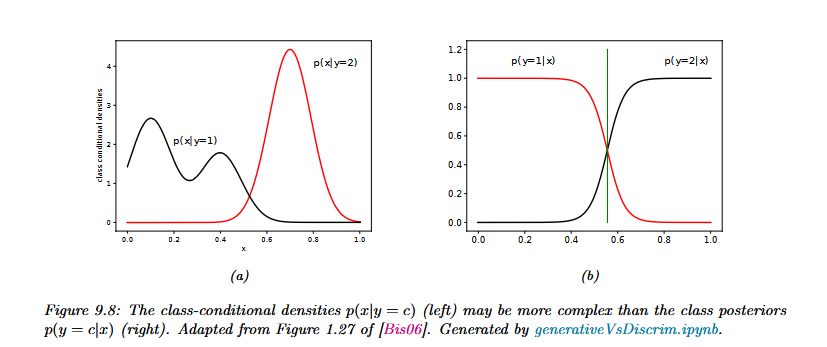
  <figcaption style="margin-top: 8px; font-size: 0.9em; color: #a0a0a0;">
    <em>complicated class-conditionals, simple posterior.</em> 
    
      Image from: probml:book 1 | Adapted from <a href="[https://www.microsoft.com/en-us/research/wp-content/uploads/2006/01/Bishop-Pattern-Recognition-and-Machine-Learning-2006.pdf](https://www.microsoft.com/en-us/research/wp-content/uploads/2006/01/Bishop-Pattern-Recognition-and-Machine-Learning-2006.pdf)">Bishop (2006)</a> | Interactive implementation in <a href="[https://probml.github.io/notebooks#generativeVsDiscrim.ipynb](https://probml.github.io/notebooks#generativeVsDiscrim.ipynb)">ProbML Notebook</a>
    
  </figcaption>
</figure>

The converse fails. A logistic posterior doesn't mean the classes are Gaussian. Any class-conditionals from the exponential family (a broad family that includes the Gaussian, the Bernoulli and the Poisson) give a logistic posterior, provided they share a dispersion (Bishop PRML §4.2). Logistic regression assumes only what they all have in common. <!-- CHECK -->

So in both pairs the difference is the route, not the form. The generative model fits each class by maximising the joint likelihood and then reads the weights off what it fitted. Logistic regression maximises the conditional likelihood and fits the weights directly. It's the same form, but you get different weights from the same data, because the generative weights are tied (2.6) to parameters that also have to explain $X$.

The Bayesian version breaks the symmetry. Bayesian Naive Bayes stayed closed form thanks to a conjugate prior (3.3.2), but logistic regression has no conjugate prior, so its posterior over $w$ has no closed form. The standard workaround is the Laplace approximation (yes, another Laplace; see the box in 2.5), which replaces that posterior with a Gaussian centred at its peak, with a width set by the curvature there (PML ch. 10). Closed form versus approximation is 3.2's contrast all over again. <!-- NOTE: fourth "Laplace"; point to the name-collisions box in 2.5. -->

### 3.5.4 Who wins

Ng & Jordan answered this for the Naive Bayes pair. Naive Bayes gets close to its best possible error in about $\log d$ examples, while logistic regression needs about $d$. But when the independence assumption is wrong, logistic regression's best error is lower. So the generative model wins early, and the discriminative model wins late.

<!-- FIGURE: schematic crossing learning curves, test error vs number of training examples; orange (Naive Bayes) drops fast to a higher plateau, blue (logistic regression) drops slowly to a lower one; labelled "schematic" --><figure style="float: left; margin-right: 20px; margin-bottom: 15px; width: 320px; text-align: center;">
  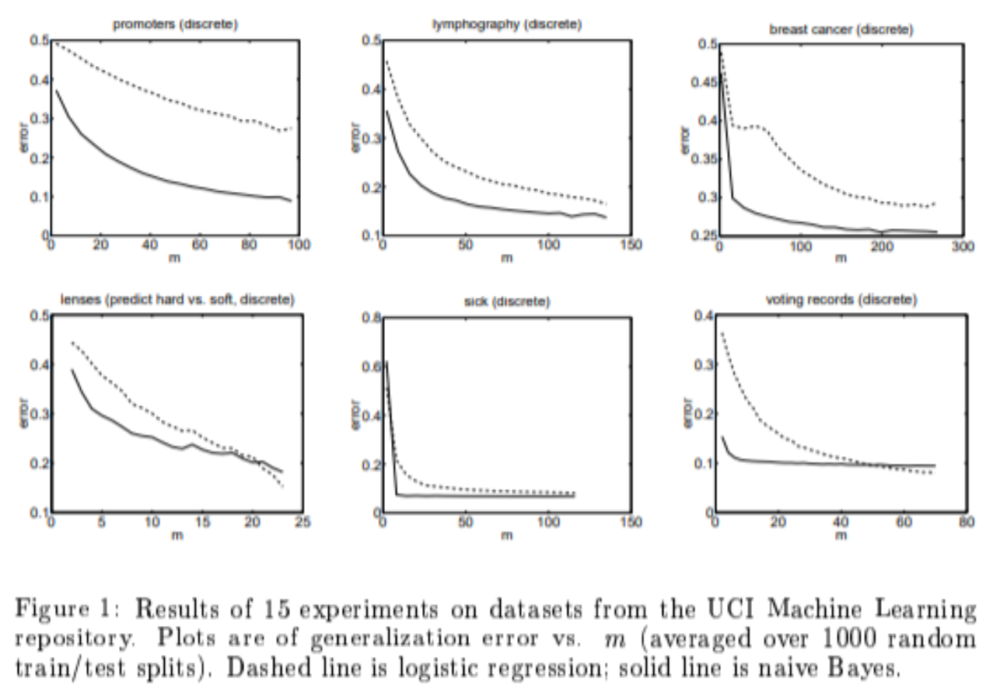
  <figcaption style="margin-top: 6px; font-size: 0.85em; color: #a0a0a0;">
    <em>Schematic learning curves for the Naive Bayes–logistic regression pair.</em>
  </figcaption>
</figure>

generalisation error against training set size $m$ on UCI datasets, averaged over 1000 random train/test splits. Dashed line: logistic regression. Solid line: Naive Bayes.*

For the Gaussian pair, the classical evidence is Efron's (1975), and it points the other way. When the Gaussian assumption holds exactly, logistic regression needs roughly 1.5 to 2 times as much data as the generative fit to reach the same accuracy. The discriminative model pays for its robustness even when nothing was wrong. <!-- CHECK: Efron 1975, JASA 70(352), efficiency of logistic regression relative to normal discriminant analysis -->

Xue and Titterington (2008) revisited Ng and Jordan's comparison and found the two-regime story is often over-generalised. On real datasets the learning curves do not always cross where the folklore says they will, and sometimes they do not cross at all. The result is better read as a tendency than as a law.

Separable data is where the two routes differ most. If a line splits the classes perfectly, logistic regression can raise its likelihood towards one by steepening the sigmoid, so its weights grow without bound and no finite maximiser exists. It needs a prior, such as weight decay, to stay finite. GDA's class means and covariances remain finite whatever the data looks like, because modelling $X$ supplies the stability.

Murphy (2022, §9.4) summarises the broader trade. Modelling $X$ gives the generative side three things. Missing features can be marginalised out or dropped. Unlabelled data can be used. And $P(X)$ can flag inputs that look unusual. The discriminative side makes fewer assumptions and reaches a better asymptote, but it needs more labels and has no $P(X)$ to consult.

Neither end is forced on you. Bouchard and Triggs (2004) blend the two likelihoods with a mixing weight, which makes the two paradigms the endpoints of a continuum rather than a binary choice.

The generative side is also still in use. Lee et al. (2018) fit class-conditional Gaussians with a shared covariance to the features of a trained deep network and use the Mahalanobis distance to flag out-of-distribution inputs.

**Try it.** If you double every spam email in the training set, which of Naive Bayes's weights change, and which of logistic regression's? On perfectly separable data, what does LDA's $w$ look like next to logistic regression's? And with only 50 labelled emails and a 10,000-word vocabulary, which member of the pair would you start with, and why? Answers are in the cheat sheet.

<!---

## Verify

- Efron (1975): check the title and venue (JASA), and the "1.5–2× the data" figure for logistic regression under true normality.
- Bishop PRML §4.2: check that exponential-family class-conditionals with a shared dispersion give a logistic or softmax posterior.
- Xue & Titterington (2008): check the paper and that it argues the two-regime picture is over-generalised.
- Bouchard & Triggs (2004): check the paper and that it interpolates between joint and conditional likelihoods.
- Lee et al. (2018, NeurIPS): check that it fits class Gaussians with a shared covariance on deep features to detect unusual inputs.

## Judgement calls

- The kit repeated 3.5.3 and 3.5.4 after the "Rung 1 so far" line. I treated that as a paste artefact and drafted all of 3.5 once, in order.
- The "free" example (60% versus 5%, giving a weight of ≈ 3.35) is invented for concreteness. Swap in real figures or cut it.
- The parked §2 text and spam Example 3 weren't attached. I wrote the buys/costs beat from the beat's own points and left a marker for Example 3.
- I didn't state Ng & Jordan's continuous-feature experiments, since the Facts flagged them as needing a check first.
- I glossed the exponential family in one clause, since the reader may not have read the GLM post.
- I glossed the Laplace approximation's covariance as "width set by the curvature", to avoid the undefined term "Hessian".
- I wrote the 2.5 name-collision pointer as a parenthetical, per the NOTE, and kept the NOTE comment.
- I named weight decay (2.4) as the prior that fixes separable data. That's a small callback beyond the beat.
- The three try-it questions are mine. One is about duplicating data, one about separability and one about data scarcity.
- The draft runs about 1,450 words of prose, slightly over the 1,100–1,400 total. The easiest trims are the "free" example and the multi-class LDA paragraph.-->

# 4 Rung 2: Structured Models

Every class in Rung 1 was a single cloud (3.1.1) or a single set of coins (3.1.2). Real data rarely cooperates that well. A class can be made of several groups, and a sentence's tags can depend on one another. In both cases there is structure we never directly see.

## 4.1 Hidden causes: latent variables and mixtures

One Gaussian per class can't fit a class with several peaks, like the left panel of Fig 9.8 in 3.5.3. However we stretch or tilt the ellipse, it puts its mass in the valley between the peaks.

So add a latent variable $z$: a choice that shaped the data but that we never observe. Here $z$ is the group a point came from, and each group gets its own Gaussian. That model is a Gaussian mixture model (GMM):

$$p(X) = \sum_{k=1}^{K} \pi_k\, \mathcal{N}(X \mid \mu_k, \Sigma_k)$$

The probability of $X$ is a weighted sum of $K$ Gaussian clouds, where each weight $\pi_k$ is that group's share of the data and the weights add to one.

Think of a "ham" class that is really two kinds of email, newsletters and receipts, each with its own word pattern. One cloud has to straddle both kinds. Two clouds can each settle on one. <!-- SIMPLIFICATION: with binary word features the groups would be sets of coins (a Bernoulli mixture), not Gaussians; the idea is the same. -->

Fitting a GMM has a catch: if we knew $z$, it would be 3.2's counting and averaging, but we don't. So we alternate. First, guess how strongly each point belongs to each group. Then refit each Gaussian to its weighted share of the points. Repeat. This is EM, short for expectation–maximisation, and no round ever lowers the likelihood. Notice the direction of travel: a GMM per class relaxes 3.3.1's constraints rather than tightening them.

<!-- SIMPLIFICATION: EM finds a local optimum; initialisation matters. -->

The cost is that $P(X)$ is now a sum over hidden choices. With a handful of groups, that sum is easy. With millions of hidden choices, it isn't, and that is Rung 3's problem.

## 4.2 The same pair, one level up: HMM and CRF

Now suppose we want to label every word in a sentence, tagging names, places and organisations. In "Ada Lovelace visited London", "Lovelace" is far more likely to be a name because "Ada" was one. Each tag depends on its neighbours, so the labels have structure of their own.

The generative side is the hidden Markov model (HMM). The tags form a chain: each tag depends on the one before it, through $P(y_t \mid y_{t-1})$, and each tag generates its word, through $P(x_t \mid y_t)$. It models $P(\text{words}, \text{tags})$, which makes it Naive Bayes stretched along a sequence.

The discriminative side is the linear-chain conditional random field (CRF) (Lafferty, McCallum & Pereira, 2001). It models $P(\text{tags} \mid \text{words})$ directly, which makes it logistic regression stretched along a sequence.

This is the same trade as in 3.5. The CRF never models the words, so it can freely use rich, overlapping features of the whole sentence, such as capitalisation, suffixes and neighbouring words, without counting the same evidence twice. The HMM has to explain each word, so it is stuck with simple features. In return, a fully labelled HMM fits by counting transitions and emissions (3.2), while the CRF has to follow the slope.

<!-- FIGURE (optional): 2×2 grid. Rows: single label, sequence. Columns: generative (orange, left), discriminative (blue, right). Cells: Naive Bayes → logistic regression; HMM → linear-chain CRF. After Sutton & McCallum (2012). -->
<!-- CHECK: figure number in Sutton & McCallum, "An Introduction to Conditional Random Fields" (2012) -->
*Caption placeholder: Rung 1's pair, repeated along a sequence.*

Both models here keep their hidden structure small and discrete: a few groups, a few tags. Deep models don't.

<!---

**Word count:** ~600

## Verify

- Sutton & McCallum (2012): find the figure number for the NB/LR/HMM/CRF grid.
- "Ada Lovelace visited London": this is my own invented example sentence, so nothing needs verifying beyond whether you want to keep it.

## Judgement calls

- I added a SIMPLIFICATION for the newsletter/receipt example, because binary word features would really give a Bernoulli mixture, not a Gaussian one.
- I glossed π_k as the "group's share" to separate it from the class prior π_c, since the two share a symbol.
- I added the "Ada Lovelace" sentence to make the tagging problem concrete (four moves: one example).
- I named the HMM's transition and emission terms inline, using the Facts, without displaying them, since only the GMM equation was listed.
- "Without counting the same evidence twice" links back to 3.1.2's double counting, without naming the section.
- At about 600 words the draft runs over the ~500 target. The easiest trims are the opening's "however we stretch" line and the HMM chain detail.

## Already covered

§4 introduced latent variables, Gaussian mixtures and EM (as alternating guess-and-refit), and showed HMM ↔ linear-chain CRF as Rung 1's generative–discriminative pair applied to sequences.
-->

# 5 Rung 3: Deep Generative Models

How would you write down $P(X)$ for a photo? A 256×256 colour image has 196,608 pixel values, each with 256 levels, so the space has $256^{196{,}608}$ possible images. No table could list them, and 4.1's small sum over groups doesn't scale anywhere near that far. The no-free-guesses problem from 2.5 now applies at full size. Every family in this rung is one answer to the same question: if we can't write $P(X)$ down, how do we model it?

<figure style="text-align: center; margin: 20px 0;">
  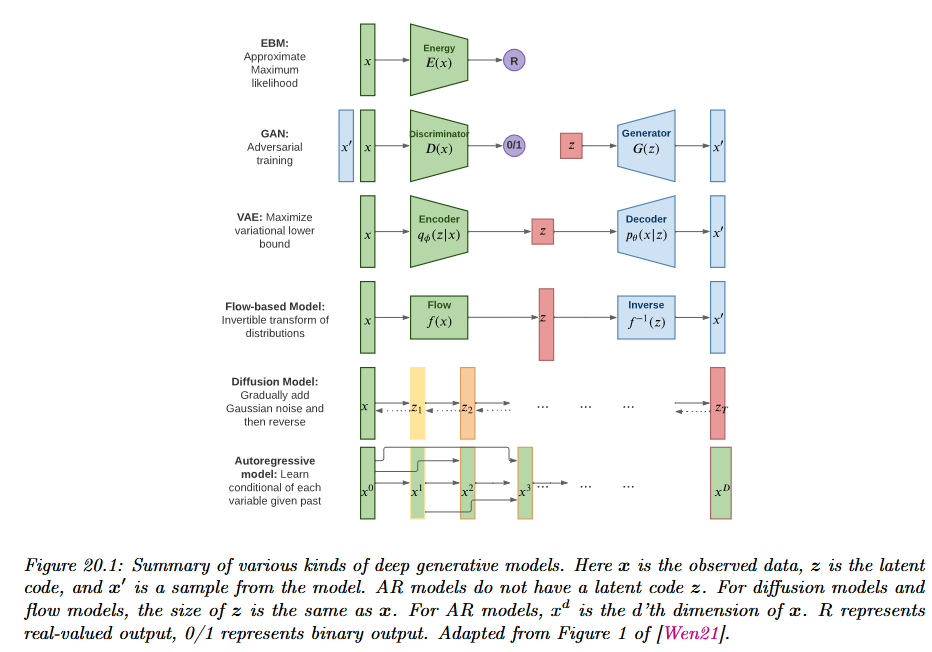
  <figcaption style="margin-top: 8px; font-size: 0.9em; color: #a0a0a0;">
    <em>The deep generative model families at a glance.</em> 
    
      Adapted from <em>ProbML: Advanced Topics</em> | origin: <a href="https://lilianweng.github.io/posts/2021-07-11-diffusion-models/">Lilian Weng's post on Diffusion Models</a>
    
  </figcaption>
</figure>

To read the map, take $X$ as the data, $z$ as a hidden code and $X'$ as a sample the model produces.

| Family | How it handles $P(X)$ | Where a discriminative part hides | Buys | Costs |
|---|---|---|---|---|
| Autoregressive | Exact: chain rule, one piece at a time | Each piece is a next-token classifier | Exact likelihood, strong text | Slow, one-by-one sampling |
| Flow | Exact: invertible map to simple noise | Barely; the whole network serves the density | Exact likelihood, fast sampling | Invertibility limits architecture |
| VAE | Lower bound (ELBO) with latent $z$ | The encoder maps $X$ to $z$ | Fast sampling, a useful $z$ | Loose bound; samples often blurry |
| Diffusion | Bound, via learning to denoise | The denoiser is a regression net | High quality; can condition on $c$ | Many steps to sample |
| GAN | No likelihood at all | The discriminator *is* a classifier | Sharp samples | Unstable training; can't score $P(X)$ |
| EBM | Unnormalised score | A classifier's logits can be read as energies | Any network can be an energy | Normaliser intractable; hard to train |

## 5.1 Exact likelihood: autoregressive models and flows

The most direct answer is to break $X$ into pieces and use the chain rule, just as GPT did in 2.7:

$$p(X) = \prod_{i=1}^{d} p(x_i \mid x_{<i})$$

The probability of the whole is the product of the probability of each piece, given every piece before it. Each factor is a classifier over the next piece, a word or a pixel value, conditioned on what came earlier. So an autoregressive model is a generative model built entirely out of discriminative parts. The likelihood is exact, but sampling has to go one piece at a time.

Flows take another route to exactness. They transform simple noise into data through an invertible map, so every sample can be traced back to its noise and its probability computed exactly (Rezende & Mohamed, 2015). <!-- CHECK: Rezende & Mohamed 2015 as the flows citation --> The price is flexibility, because every layer has to stay invertible.

## 5.2 Bounds and latent codes: VAEs and diffusion

A variational autoencoder (VAE) gives every image a hidden code $z$ (Kingma & Welling, 2013). That's 4.1's latent variable again, but now continuous and with hundreds of dimensions instead of a handful of groups. An encoder $q(z \mid X)$ maps each image to its code, and a decoder maps codes back to images. Summing over every possible $z$ is now impossible, so the VAE maximises a lower bound on $\log p(X)$ instead, called the ELBO. In words, the ELBO rewards reconstructing $X$ well from its code and penalises codes that drift from simple noise. That drift is measured by the KL divergence, a measure of how different one distribution is from another that is zero only when they match.

KL has a direction, and the direction matters. MLE minimises the KL from the data to the model, which punishes the model heavily for missing any region where data lives, so the model spreads out to cover everything and its samples blur. Reverse the direction and the penalty falls on putting mass where there is no data, so the model clings to a few sharp regions and may drop others entirely, blurriness also comes from the decoder's Gaussian assumption (callback 2.5). 

Diffusion models (Ho et al., 2020) destroy an image on purpose: they add noise in many small steps until nothing of the image is left, then train a network to undo a single step. The denoiser predicts the noise that was added and is trained with MSE, which makes it a plain regression net. That's 2.5's Gaussian-to-MSE link at work. Its loss is a stand-in for $\log P(X)$, tied to a bound much like the VAE's.

Now give the denoiser a class label or a text prompt $c$. It then models $P(X \mid c)$, which is exactly the class-conditional $P(X \mid y)$ of Rung 1, but over images. Hold on to this; it comes back in §7.

## 5.3 No likelihood, or no normaliser: GANs and EBMs

A generative adversarial network (GAN) gives up on likelihood entirely (Goodfellow et al., 2014). A generator turns noise into samples, and a discriminator classifies each sample as real or fake; each trains against the other. That answers 2.7's question in the most literal way possible: the discriminator is a discriminative model, and the system as a whole is generative. In practice, the generator can also collapse onto a few kinds of sample, a failure related to reverse KL's habit of dropping regions.

SIMPLIFICATION: GAN mode-dropping is linked to, not identical with, reverse KL.

From first principles, the best possible discriminator is $D^*(X) = p_{\text{data}}(X) / (p_{\text{data}}(X) + p_g(X))$. It is built from the ratio of the data's density to the generator's density. So the classifier is secretly measuring a density ratio, which is the same trick as 2.6's noise-contrastive estimation.

An energy-based model (EBM) asks even less of the network. Any network can give each $X$ a score called its energy, $E(X)$, where low energy means likely. Turning energies into probabilities, $p(X) = \exp(-E(X)) / Z$, needs a normaliser $Z$ summed over every possible $X$, and that sum is intractable, so training has to be approximate. Here's the plant: a classifier's outputs can be read as energies, and §7 makes use of that.

Flow matching is now the state of the art for training continuous flows, and it is being extended towards discrete data such as text (Lipman et al., 2022; guide, 2024). <!-- CHECK: Lipman et al. 2022 and the 2024 flow-matching guide; "current state of the art" claim --> Meanwhile, deep discriminative classifiers take a different risk, shortcuts, which §7 returns to.

<!---

**Word count:** ~1,130 (prose, excluding the table)

## Verify

- 256×256 image arithmetic (196,608 values, $256^{196{,}608}$ images): this is my own calculation, so check you're happy with the example.
- Rezende & Mohamed (2015): confirm it as the flows citation.
- Lipman et al. (2022) and the 2024 guide: confirm both, and that "state of the art for continuous flows" is defensible.
- Table, Flow row: check "barely; the whole network serves the density" as the discriminative-part entry.
- Table, EBM row: check "a classifier's logits can be read as energies" (this plants §7).

## Judgement calls

- Fig 20.1 wasn't attached, so I left an ASSET marker and a caption placeholder, with the reading sentence as its own line.
- I filled the Flow "discriminative part" cell as "barely", since I don't think flows hide a classifier. Change it if you have a reading in mind.
- I defined KL in one clause in the VAE beat, because the context doesn't list it as covered in 2.3.
- I mentioned GAN mode collapse in one sentence so the SIMPLIFICATION comment has prose to attach to. Cut both if they're unwanted.
- I wrote the optimal discriminator and the EBM normaliser inline, since only the chain-rule equation was cleared for display.
- I named §7 in the conditional-diffusion and EBM plants, as the beats asked.

## Already covered

§5 introduced the deep generative families by how they handle intractable $P(X)$: exact likelihood (autoregressive, flows), lower bounds (VAE's ELBO with KL defined; diffusion as MSE denoising, including conditional $P(X \mid c)$), and no likelihood or no normaliser (GANs with the density-ratio discriminator; EBMs with energy $E(X)$ and intractable $Z$).
-->
# 6 Settings: Beyond Labelled Classification

## 6.1 Unlabelled data

Labels cost money and time; unlabelled inputs are almost free. A spam filter might have a thousand hand-labelled emails and a million unlabelled ones sitting in the same inbox. Can those million help?

On the generative side, they can at least be used. Unlabelled $X$ still contributes to the $\log P(X)$ term in 2.6's split, so a generative classifier has somewhere to put it, which is the EM line from 3.3.2. But it helps only when the model's assumptions are roughly right; when they're wrong, the extra data can pull the fit the wrong way and make things worse (Nigam et al., 2000; Cozman & Cohen). <!-- CHECK: Nigam et al. 2000; Cozman & Cohen, year and paper -->

Schölkopf et al. (2012) traced the answer to a first principle: causal direction. Sometimes the label causes the input. The digit someone meant to write causes the strokes on the page, so the shape of $P(X)$ carries information about $P(y \mid X)$, and unlabelled data can help. Sometimes the input causes the label. Rainfall causes crop yield, so knowing how rainfall is distributed tells you nothing about the mechanism that turns rain into crops, and unlabelled data can't help.

<!-- SIMPLIFICATION: the paper's claim is about when semi-supervised learning CAN help, not a guarantee. -->

That gives a generative classifier's factorisation a new reading. $P(y) \cdot P(X \mid y)$ first picks a label and then generates features from it, which is exactly the causal story when labels cause features. In that setting, the generative model's structure isn't just an assumption; it matches how the data was made.

## 6.2 Reinforcement learning
 
An agent doesn't just predict; it has to act. At each step it sees a state $s_t$, picks an action $a_t$, collects a reward $r_t$, and the world moves to a new state $s_{t+1} \sim P(s' \mid s_t, a_t)$. The goal is a policy $\pi_\theta(a \mid s)$ that maximises the expected discounted return
 
$$
J(\theta) = \mathbb{E}_{\tau \sim p_\theta}\Big[\sum_{t=0}^{T}\gamma^t r_t\Big], \qquad p_\theta(\tau) = p(s_0)\prod_{t}\pi_\theta(a_t \mid s_t)\,P(s_{t+1}\mid s_t, a_t).
$$
 
Three things can be learned from experience. The *policy* $\pi_\theta(a \mid s)$ is a conditional distribution over actions, the same kind of object as a classifier. The *value* $Q^\pi(s,a) = \mathbb{E}\big[\sum_k \gamma^k r_{t+k} \mid s_t = s, a_t = a\big]$ is the average return from a state-action pair, so a network trained to predict it with squared error is estimating a conditional mean (2.5). The *world model* $P(s' \mid s, a)$ is the only one of the three that describes how the world generates data. Whether the agent learns the third one or skips it is the same fork as before.
 
**The model-free route** learns the policy or the value directly. Two examples show how plainly it connects to the losses already seen.
 
- *Value-based (Q-learning).* Regress $Q_\theta(s,a)$ towards the target $y = r + \gamma\max_{a'}Q_\theta(s',a')$ with squared error. The label is built from the network's own output, so the target moves as the network learns.
- *Policy gradient.* The log-derivative trick, $\nabla_\theta\mathbb{E}[R(\tau)] = \mathbb{E}\big[R(\tau)\,\nabla_\theta\log p_\theta(\tau)\big]$, together with the factorisation of $p_\theta(\tau)$ above, gives
$$
\nabla_\theta J(\theta) = \mathbb{E}\Big[\sum_{t}\nabla_\theta\log\pi_\theta(a_t\mid s_t)\,G_t\Big], \qquad G_t = \sum_{k\ge t}\gamma^{k-t}r_k .
$$
 
The transition probabilities $P(s_{t+1}\mid s_t,a_t)$ contain no $\theta$, so they vanish from $\nabla_\theta\log p_\theta(\tau)$. This is why no world model is needed. The loss $-\sum_t G_t\log\pi_\theta(a_t\mid s_t)$ is the cross-entropy on the actions the agent took, each weighted by the return that followed (Williams, 1992). Set every weight to 1 on an expert's actions and it is ordinary supervised classification. The price is variance, since $G_t$ is a noisy sample, and a large number of interactions.
 
**The model-based route** fits $\hat P_\phi(s' \mid s, a)$ and a reward model to the logged transitions by maximum likelihood, $\mathcal{L}(\phi) = -\mathbb{E}\log\hat P_\phi(s'\mid s,a)$. With a Gaussian this is a squared error on the next state. The supervision is dense: every transition gives the full next state as a training signal, while the reward is a single scalar that may be zero for thousands of steps. The agent then plans by simulating ahead, either choosing actions by search at decision time, or training a policy on imagined rollouts (Dyna; Sutton, 1990). This is why model-based agents are sample-efficient, as SimPLe showed on Atari with a budget of 100k agent steps (Kaiser et al., 2020). <!-- CHECK: Kaiser et al. 2020 SimPLe and the 100k-step budget claim -->
 
The cost is that errors in the model leak into everything built on it, in two ways.
 
- **Compounding.** The model is trained to predict one step from states the data-collecting policy visited. A rollout feeds the model's own predictions back in as inputs and drifts away from those states. In the worst case, the value error grows with the square of the effective horizon $1/(1-\gamma)$ (Kearns & Singh, 2002). <!-- CHECK: Kearns & Singh 2002, the quadratic dependence on the horizon -->
- **Exploitation.** A planner searches for action sequences that look best under the model, so it finds exactly the places where the model is wrong in the optimistic direction. Any blind spot becomes an optimum. Ensembles that expose uncertainty (Chua et al., 2018) and short rollouts started from real states (Janner et al., 2019) limit the damage.
**The objective decides again.** The two routes are not a fixed binary, because a world model can be trained for different purposes.
 
- *Dreamer* (Hafner et al., 2020) trains a latent world model with a likelihood objective, reconstruction plus KL, which is a VAE over time. It then learns a policy entirely inside imagined latent rollouts.
- *MuZero* (Schrittwieser et al., 2020) never reconstructs an observation. Its model is trained only to predict the reward, the value and the policy at each step of an unrolled latent sequence, and it plans over that model with tree search. The value-equivalence principle (Grimm et al., 2020) explains why this can be enough: a model only has to agree with the world on what changes the value of the policies being compared. The structure is model-based but the objective is a prediction loss, so it sits on the discriminative side of the grid. The trade is accuracy where it matters against a model that is useless outside the task it was trained for.
**Imitation learning** repeats the pattern when the signal is an expert's behaviour instead of a reward. Behaviour cloning fits $\pi_\theta(a \mid s)$ to the expert's state-action pairs with a cross-entropy or squared-error loss, which is plain supervised learning. It fails the same way a rolled-out world model does: one small mistake puts the agent in a state the expert never visited, where the training data says nothing, so errors compound with the length of the episode. In the worst case the loss grows quadratically in the horizon $T$, and DAgger (Ross et al., 2011) fixes it by asking the expert to label the states the learner actually reaches. <!-- CHECK: Ross, Gordon & Bagnell 2011, the T^2 bound for behaviour cloning --> GAIL (Ho & Ermon, 2016) goes the generative way. A discriminator $D(s,a)$ learns to tell expert pairs from the agent's, the agent is trained to fool it, and the discriminator's output becomes the reward. At the optimum, $D^\star = \rho_E/(\rho_E + \rho_\pi)$, a ratio of the two occupancy distributions over state-action pairs, so it is the same density-ratio trick a GAN's discriminator uses. <!-- CHECK: Ho & Ermon 2016, that the objective matches occupancy measures up to a regulariser (a JS-type divergence) -->
 
| Approach | What it learns | Trained with | Typical failure |
|:--|:--|:--|:--|
| Q-learning | $Q(s,a)$ | Squared error to a bootstrapped target | Moving targets; many interactions |
| Policy gradient | $\pi_\theta(a\mid s)$ | Return-weighted log-likelihood | High-variance gradient; many interactions |
| Model-based (Dyna, PETS, MBPO) | $P(s'\mid s,a)$ and reward | NLL, often a squared error on the next state | Compounding error; planner exploits the model |
| Dreamer | Latent world model, then a policy | Reconstruction + KL (an ELBO), then actor-critic in imagination | Model capacity spent on detail the task does not need |
| MuZero | Latent model for planning | Reward, value and policy prediction | Model valid only for the task it was trained on |
| Behaviour cloning | $\pi_\theta(a\mid s)$ from an expert | Cross-entropy or squared error | Drifts off the expert's states; errors compound |
| GAIL | Policy and discriminator | Adversarial BCE | GAN-style instability |

## References and further reading

### Textbooks and overviews

- Murphy (2022), [*Probabilistic Machine Learning: An Introduction*](https://probml.github.io/pml-book/book1.html), MIT Press. Ch. 9 (discriminant analysis, naive Bayes, generative vs discriminative), ch. 10 (logistic regression), ch. 11 (robust linear regression with Laplace and Student-t noise) and ch. 12 (GLMs). <!-- CHECK: chapter and section numbers -->
- Murphy (2023), [*Probabilistic Machine Learning: Advanced Topics*](https://probml.github.io/pml-book/book2.html), MIT Press. VAEs, flows, diffusion, GANs, EBMs and RL in one framework.
- Bishop (2006), [*Pattern Recognition and Machine Learning*](https://www.microsoft.com/en-us/research/publication/pattern-recognition-machine-learning/), Springer. §1.2.5 (Gaussian noise and sum-of-squares), §1.5.5 (mean and median via the Minkowski loss family), §2.4 (exponential family), §4.2 (probabilistic generative models), §4.3.2 (logistic regression, with Fig. 4.4 on least squares for binary labels), §4.3.6 (canonical link functions) and ch. 9 (mixtures and EM). <!-- CHECK: section numbers -->
- Hastie, Tibshirani & Friedman (2009), [*The Elements of Statistical Learning*](https://hastie.su.domains/ElemStatLearn/), 2nd ed., Springer. §2.4 (squared error gives the conditional mean, absolute error the median) and ch. 4 (LDA, QDA, RDA). <!-- CHECK: section numbers -->
- Goodfellow, Bengio & Courville (2016), [*Deep Learning*](https://www.deeplearningbook.org/), MIT Press. [§5.5](https://www.deeplearningbook.org/contents/ml.html) (maximum likelihood as cross-entropy; §5.5.1 on MSE as conditional log-likelihood) and [§6.2](https://www.deeplearningbook.org/contents/mlp.html) (§6.2.1.1 conditional distributions, §6.2.1.2 mean and median as minimisers of MSE and MAE, §6.2.2 sigmoid and softmax output units, including why MSE saturates with a sigmoid). <!-- CHECK: section numbers -->
- Cover & Thomas (2006), [*Elements of Information Theory*](https://doi.org/10.1002/047174882X), 2nd ed., Wiley. Ch. 2 (entropy, KL, cross-entropy).
- Nielsen, [*Neural Networks and Deep Learning*, ch. 3](http://neuralnetworksanddeeplearning.com/chap3.html). The cross-entropy cost against the quadratic cost, with the gradient comparison.

### Losses as distributions

*Mean, median and quantiles*
- Koenker & Bassett (1978), ["Regression quantiles"](https://doi.org/10.2307/1913643), *Econometrica* 46(1), 33–50. The pinball loss. Koenker (2005), [*Quantile Regression*](https://doi.org/10.1017/CBO9780511754098), Cambridge University Press, is the book-length treatment.

*Heavy tails and robust losses*
- Huber (1964), ["Robust estimation of a location parameter"](https://doi.org/10.1214/aoms/1177703732), *Annals of Mathematical Statistics* 35(1), 73–101. Huber & Ronchetti (2009), [*Robust Statistics*](https://doi.org/10.1002/9780470434697), 2nd ed., Wiley, is the textbook.
- Lange, Little & Taylor (1989), ["Robust statistical modeling using the t distribution"](https://www.jstor.org/stable/2290063), *JASA* 84(408), 881–896. Student-t likelihoods and their influence function.

*Predicting the noise level too*
- Nix & Weigend (1994), ["Estimating the mean and variance of the target probability distribution"](https://doi.org/10.1109/ICNN.1994.374138), *Proc. IEEE ICNN*.
- Kendall & Gal (2017), ["What uncertainties do we need in Bayesian deep learning for computer vision?"](https://arxiv.org/abs/1703.04977), *NeurIPS*.

*Exponential family, canonical links, GLMs*
- Nelder & Wedderburn (1972), ["Generalized linear models"](https://doi.org/10.2307/2344614), *JRSS A* 135(3). The original paper.
- McCullagh & Nelder (1989), [*Generalized Linear Models*](https://doi.org/10.1201/9780203753736), 2nd ed., Chapman & Hall.

### Generative vs discriminative

- Ng & Jordan (2001), ["On discriminative vs. generative classifiers: a comparison of logistic regression and naive Bayes"](https://papers.nips.cc/paper/2001/hash/7b7a53e239400a13bd6be6c91c4f6c4e-Abstract.html), *NeurIPS*. The two-regime result for the naive Bayes and logistic regression pair.
- Efron (1975), ["The efficiency of logistic regression compared to normal discriminant analysis"](https://doi.org/10.1080/01621459.1975.10480319), *JASA* 70(352), 892–898. The classical result for the Gaussian pair. <!-- CHECK: DOI -->
- Xue & Titterington (2008), ["Comment on 'On discriminative vs. generative classifiers…'"](https://doi.org/10.1007/s11063-008-9088-7), *Neural Processing Letters* 28(3), 169–187. Why the two-regime claim does not always hold.
- Minka (2005), ["Discriminative models, not discriminative training"](https://www.microsoft.com/en-us/research/publication/discriminative-models-not-discriminative-training/), Microsoft Research TR-2005-144. The tied-parameters argument.
- Jebara, *Discriminative, Generative and Joint Learning*, Columbia University. [PDF](https://www.cs.columbia.edu/~jebara/papers/jebara4.pdf). Jebara (2004), [*Machine Learning: Discriminative and Generative*](https://doi.org/10.1007/978-1-4419-9011-2), Springer, is the source of the objective-by-treatment grid. <!-- CHECK: DOI -->
- Bishop & Lasserre (2007), ["Generative or discriminative? Getting the best of both worlds"](https://microsoft.com/en-us/research/wp-content/uploads/2016/05/Bishop-Valencia-07.pdf), *Bayesian Statistics 8*. Blending the two likelihoods.
- Bouchard & Triggs (2004), "The trade-off between generative and discriminative classifiers", *COMPSTAT*. Ch. 5 of [Bouchard's thesis](https://lear.inrialpes.fr/people/bouchard/these/summaryphd.html) covers it in English. <!-- CHECK: no direct link to the conference paper -->

### Fitting and overfitting generative classifiers

*The naive Bayes assumption and calibration*
- Domingos & Pazzani (1997), ["On the optimality of the simple Bayesian classifier under zero-one loss"](https://doi.org/10.1023/A:1007413511361), *Machine Learning* 29, 103–130.
- Zhang (2004), ["The optimality of naive Bayes"](https://cdn.aaai.org/FLAIRS/2004/Flairs04-097.pdf), *Proc. 17th FLAIRS Conference*. Dependencies that cancel.
- Zadrozny & Elkan (2001), ["Obtaining calibrated probability estimates from decision trees and naive Bayesian classifiers"](https://cseweb.ucsd.edu/~elkan/calibrated.pdf), *ICML*, 609–616.
- Niculescu-Mizil & Caruana (2005), ["Predicting good probabilities with supervised learning"](https://doi.org/10.1145/1102351.1102430), *ICML*. <!-- CHECK: DOI -->
- Guo, Pleiss, Sun & Weinberger (2017), ["On calibration of modern neural networks"](https://arxiv.org/abs/1706.04599), *ICML*.

*Covariance estimation in high dimensions*
- Friedman (1989), ["Regularized discriminant analysis"](https://doi.org/10.1080/01621459.1989.10478752), *JASA* 84(405). The original RDA paper. <!-- CHECK: DOI -->
- Ledoit & Wolf (2004), ["A well-conditioned estimator for large-dimensional covariance matrices"](https://doi.org/10.1016/S0047-259X(03)00096-4), *J. Multivariate Analysis*. Eigenvalue distortion and shrinkage.
- Marchenko & Pastur (1967), "Distribution of eigenvalues for some sets of random matrices", *Mat. Sb.* 72(114). The eigenvalue law behind the $[(1-\sqrt\gamma)^2,(1+\sqrt\gamma)^2]$ interval. <!-- CHECK: add a link -->
- Bickel & Levina (2004), ["Some theory for Fisher's linear discriminant function, 'naive Bayes', and some alternatives when there are many more variables than observations"](https://doi.org/10.3150/bj/1106314847), *Bernoulli* 10(6). <!-- CHECK: DOI -->
- Geman, Bienenstock & Doursat (1992), ["Neural networks and the bias/variance dilemma"](https://doi.org/10.1162/neco.1992.4.1.1), *Neural Computation* 4(1).

### Latent variables, EM and unlabelled data

- Dempster, Laird & Rubin (1977), ["Maximum likelihood from incomplete data via the EM algorithm"](https://doi.org/10.1111/j.2517-6161.1977.tb01600.x), *JRSS B*. <!-- CHECK: DOI -->
- Nigam, McCallum, Thrun & Mitchell (2000), ["Text classification from labeled and unlabeled documents using EM"](https://doi.org/10.1023/A:1007692713085), *Machine Learning* 39.
- Cozman & Cohen (2002), ["Unlabeled data can degrade classification performance of generative classifiers"](https://aaai.org/?p=77106), *FLAIRS*. <!-- CHECK: confirm this AAAI page is that paper -->
- Schölkopf et al. (2012), ["On causal and anticausal learning"](https://arxiv.org/abs/1206.6471), *ICML*. When $P(X)$ can and cannot help predict $y$.
- Chapelle, Schölkopf & Zien (eds.) (2006), [*Semi-Supervised Learning*](https://doi.org/10.7551/mitpress/9780262033589.001.0001), MIT Press. <!-- CHECK: DOI -->

### Noise-contrastive estimation and energy-based models

- Gutmann & Hyvärinen (2010), ["Noise-contrastive estimation"](https://proceedings.mlr.press/v9/gutmann10a.html), *AISTATS*.
- LeCun, Chopra, Hadsell, Ranzato & Huang (2006), ["A tutorial on energy-based learning"](http://yann.lecun.com/exdb/publis/pdf/lecun-06.pdf).
- Song & Kingma (2021), ["How to train your energy-based models"](https://arxiv.org/abs/2101.03288), arXiv:2101.03288.

### Deep generative models

*Overview*
- Goodfellow (2016), ["NIPS 2016 tutorial: generative adversarial networks"](https://arxiv.org/abs/1701.00160). Includes a clear taxonomy of generative models by how they handle the likelihood.

*Autoregressive models*
- Bengio, Ducharme, Vincent & Jauvin (2003), ["A neural probabilistic language model"](https://jmlr.org/papers/v3/bengio03a.html), *JMLR* 3. The chain-rule factorisation with a softmax at each position.
- van den Oord, Kalchbrenner & Kavukcuoglu (2016), ["Pixel recurrent neural networks"](https://arxiv.org/abs/1601.06759), *ICML*. The same factorisation over pixels.

*Flows*
- Rezende & Mohamed (2015), ["Variational inference with normalizing flows"](https://arxiv.org/abs/1505.05770), *ICML*.
- Papamakarios et al. (2021), ["Normalizing flows for probabilistic modeling and inference"](https://arxiv.org/abs/1912.02762), *JMLR* 22. The standard survey.
- Lipman et al. (2022), ["Flow matching for generative modeling"](https://arxiv.org/abs/2210.02747), *ICLR*. Lipman et al. (2024), ["Flow matching guide and code"](https://arxiv.org/abs/2412.06264).

*VAEs*
- Kingma & Welling (2014), ["Auto-encoding variational Bayes"](https://arxiv.org/abs/1312.6114), *ICLR*.
- Kingma & Welling (2019), ["An introduction to variational autoencoders"](https://arxiv.org/abs/1906.02691), *Foundations and Trends in Machine Learning*.
- Doersch (2016), ["Tutorial on variational autoencoders"](https://arxiv.org/abs/1606.05908). The easier route to the Gaussian-decoder-to-MSE step.

*Diffusion*
- Sohl-Dickstein et al. (2015), ["Deep unsupervised learning using nonequilibrium thermodynamics"](https://arxiv.org/abs/1503.03585), *ICML*.
- Ho, Jain & Abbeel (2020), ["Denoising diffusion probabilistic models"](https://arxiv.org/abs/2006.11239), *NeurIPS*. The Gaussian KL terms, the noise-prediction MSE and its weighting.
- Song et al. (2021), ["Score-based generative modeling through stochastic differential equations"](https://arxiv.org/abs/2011.13456), *ICLR*.
- Weng (2021), ["What are diffusion models?"](https://lilianweng.github.io/posts/2021-07-11-diffusion-models/). A step-by-step derivation.
- Dhariwal & Nichol (2021), ["Diffusion models beat GANs on image synthesis"](https://arxiv.org/abs/2105.05233), *NeurIPS*. Ho & Salimans (2022), ["Classifier-free diffusion guidance"](https://arxiv.org/abs/2207.12598). Conditioning on a class or a prompt.

*GANs*
- Goodfellow et al. (2014), ["Generative adversarial nets"](https://arxiv.org/abs/1406.2661), *NeurIPS*. The optimal discriminator and the JS result.
- Nowozin, Cseke & Tomioka (2016), ["f-GAN"](https://arxiv.org/abs/1606.00709), *NeurIPS*. GANs as divergence minimisation for general f-divergences.

### Reinforcement learning and imitation

*Foundations*
- Sutton & Barto (2018), [*Reinforcement Learning: An Introduction*](http://incompleteideas.net/book/the-book-2nd.html), 2nd ed. Ch. 3 (MDPs), ch. 8 (Dyna and planning) and ch. 13 (policy gradient, including the REINFORCE derivation).
- Murphy (2025), ["Reinforcement learning: an overview"](https://arxiv.org/abs/2412.05265), arXiv:2412.05265. Value-based, policy-gradient, model-based and imitation methods in one current text.
- OpenAI, [Spinning Up: intro to policy optimization](https://spinningup.openai.com/en/latest/spinningup/rl_intro3.html). The policy-gradient derivation step by step.
- Levine, [CS 285: Deep Reinforcement Learning](https://rail.eecs.berkeley.edu/deeprlcourse/), UC Berkeley. Lectures on model-free, model-based and imitation learning.
- Levine (2018), ["Reinforcement learning and control as probabilistic inference"](https://arxiv.org/abs/1805.00909). RL recast as maximum likelihood.

*Policy gradient and value learning*
- Williams (1992), ["Simple statistical gradient-following algorithms for connectionist reinforcement learning"](https://doi.org/10.1007/BF00992696), *Machine Learning* 8. REINFORCE.
- Mnih et al. (2015), ["Human-level control through deep reinforcement learning"](https://doi.org/10.1038/nature14236), *Nature* 518. DQN.

*Model-based RL*
- Moerland, Broekens, Plaat & Jonker (2023), ["Model-based reinforcement learning: a survey"](https://arxiv.org/abs/2006.16712), *Foundations and Trends in Machine Learning*.
- Kearns & Singh (2002), ["Near-optimal reinforcement learning in polynomial time"](https://doi.org/10.1023/A:1017984413808), *Machine Learning* 49. The error-propagation analysis behind the horizon dependence.
- Janner, Fu, Zhang & Levine (2019), ["When to trust your model: model-based policy optimization"](https://arxiv.org/abs/1906.08253), *NeurIPS*. Compounding error, with short rollouts as the fix.
- Chua, Calandra, McAllister & Levine (2018), ["Deep reinforcement learning in a handful of trials using probabilistic dynamics models"](https://arxiv.org/abs/1805.12114), *NeurIPS*. Ensembles for model uncertainty.
- Kaiser et al. (2020), ["Model-based reinforcement learning for Atari"](https://arxiv.org/abs/1903.00374), *ICLR*. SimPLe.
- Ha & Schmidhuber (2018), ["World models"](https://arxiv.org/abs/1803.10122). A VAE-based world model with a small controller trained inside it.
- Hafner et al. (2020), ["Dream to control: learning behaviors by latent imagination"](https://arxiv.org/abs/1912.01603), *ICLR*. Hafner et al. (2023), ["Mastering diverse domains through world models"](https://arxiv.org/abs/2301.04104), DreamerV3.

*Decision-focused models*
- Schrittwieser et al. (2020), ["Mastering Atari, Go, chess and shogi by planning with a learned model"](https://arxiv.org/abs/1911.08265), *Nature* 588. MuZero.
- Grimm, Barreto, Singh & Silver (2020), ["The value equivalence principle for model-based reinforcement learning"](https://arxiv.org/abs/2011.03506), *NeurIPS*.
- Hansen, Wang & Su (2022), ["Temporal difference learning for model predictive control"](https://arxiv.org/abs/2203.04955), *ICML*. TD-MPC: a latent model trained without reconstruction.

*Imitation learning*
- Ross, Gordon & Bagnell (2011), ["A reduction of imitation learning and structured prediction to no-regret online learning"](https://arxiv.org/abs/1011.0686), *AISTATS*. DAgger, with the compounding-error analysis for behaviour cloning.
- Ho & Ermon (2016), ["Generative adversarial imitation learning"](https://arxiv.org/abs/1606.03476), *NeurIPS*. GAIL.

### Where discriminative models fail, and where generative ones still help

- Geirhos et al. (2020), ["Shortcut learning in deep neural networks"](https://arxiv.org/abs/2004.07780), *Nature Machine Intelligence*.
- Hendrycks & Gimpel (2017), ["A baseline for detecting misclassified and out-of-distribution examples in neural networks"](https://arxiv.org/abs/1610.02136), *ICLR*.
- Lee, Lee, Lee & Shin (2018), ["A simple unified framework for detecting out-of-distribution samples and adversarial attacks"](https://arxiv.org/abs/1807.03888), *NeurIPS*. Class Gaussians with a shared covariance on a network's features.
- Nalisnick et al. (2019), ["Do deep generative models know what they don't know?"](https://arxiv.org/abs/1810.09136), *ICLR*. A caveat: $P(X)$ from a deep model can rate unfamiliar inputs as likely.
- Grathwohl et al. (2020), ["Your classifier is secretly an energy based model and you should treat it like one"](https://arxiv.org/abs/1912.03263), *ICLR*. Classifier logits read as energies.
- Li et al. (2023), ["Your diffusion model is secretly a zero-shot classifier"](https://arxiv.org/abs/2303.16203). Clark & Jaini (2023), ["Text-to-image diffusion models are zero-shot classifiers"](https://arxiv.org/abs/2303.15233). Conditional diffusion used as a generative classifier.

<!-- CHECK: Opened and confirmed: Murphy RL overview (arXiv), Ng & Jordan, Xue & Titterington (DOI), Domingos & Pazzani, Zhang, Zadrozny & Elkan, Lange et al. (JSTOR), Bishop & Lasserre PDF, Bouchard's thesis page. Every other link is from memory; click each before publishing. -->
<!-- CHECK: Bishop's book page is the Microsoft Research landing page; Goodfellow links go to the chapter pages (ch. 6 for §6.x, ch. 5 for §5.5). -->
<!-- CHECK: The Jebara PDF link is the one from your draft; I did not open it. -->